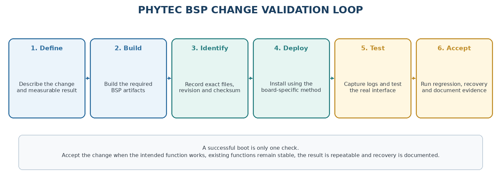
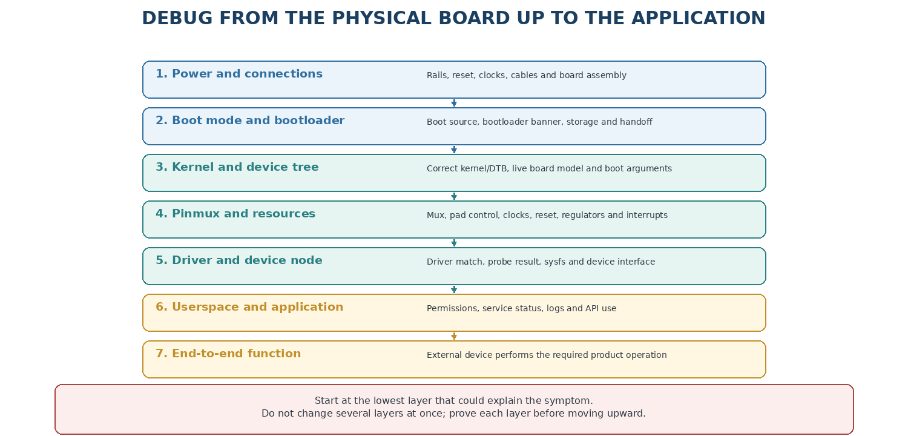
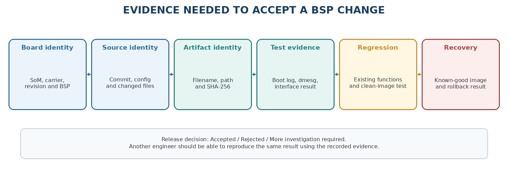

.. START:section:1:1
Overview
========

.. END:section:1:1

.. START:main_content:1:1
BSP Changes Testing and Debugging workflow. This document provides a practical validation strategy for BSP modifications, emphasizing evidence-driven testing, layered debug from low-level boot to user space, and acceptance criteria before release.

.. END:main_content:1:1

.. START:image:1:1:1

   Figure-1 BSP Change Validation Loop

.. END:image:1:1:1

|

.. START:section:1:2
1. What this document covers
============================

.. END:section:1:2

.. START:main_content:1:2
This document is the final practical workflow for changes described in the earlier guides. It does not replace the detailed kernel, device-tree, bootloader, pinmux, toolchain or runtime chapters. Instead, it explains how to apply a change and prove whether it works.

.. END:main_content:1:2

.. START:table:1:2:1

.. csv-table:: Table 1  -  Change type and minimum validation
   :header: "Change", "Minimum evidence"
   :align: center

   "Device tree or pinmux", "Live DT, pinctrl state, driver probe and hardware signal"
   "Kernel driver/configuration", "Kernel config, probe log, sysfs/device test and regression"
   "Bootloader", "Boot log, environment, kernel handoff and recovery path"
   "Root filesystem/service", "Service status, logs, application test and reboot persistence"
   "Application/toolchain", "Target architecture, dependencies, function and clean-image test"

.. END:table:1:2:1

.. START:image:1:2:2

   Figure-2 Layered Debugging Method

.. END:image:1:2:2

|

.. START:section:1:3
2. Define the expected result before building
=============================================

.. END:section:1:3

.. START:main_content:1:3
Write down what should change and what must not change. A clear expected result prevents a test from being judged only by “the board booted.”

::

   # Save a simple test record before starting
   $ board=<exact PHYTEC board>
   $ bsp_release=<release or commit>
   $ change=<short description>
   $ expected=<measurable result>
   $ baseline_image=<known-good image>
   $ recovery_method=<SD/eMMC/OSPI/UART/USB/network method>

.. END:main_content:1:3

.. START:table:1:3:1

.. csv-table:: Table 2  -  Change test definition
   :header: "Item", "Example"
   :align: center

   "Change", "Enable an SPI device on a PHYTEC carrier"
   "Expected artifact", "Board DTB or image containing the updated DTS"
   "Expected log", "SPI controller and device probe without errors"
   "Expected hardware", "Device responds to a read or loopback test"
   "Unchanged behavior", "Console, Ethernet, storage and boot remain functional"
   "Recovery", "Known-good image and documented boot-media method"

.. END:table:1:3:1

.. START:table:1:3:2

.. csv-table::
.. tip::

   Use measurable statements such as “/dev/spidevX.Y exists and reads the expected register” rather than “SPI works.”

.. END:table:1:3:2

.. START:image:1:3:3

   Figure-3 Release Evidence and Acceptance

.. END:image:1:3:3

|

.. START:section:1:4
3. Preserve a known-good baseline
=================================

.. END:section:1:4

.. START:main_content:1:4
Before deploying a change, boot the unchanged image and record its behavior. This baseline helps distinguish a new regression from a problem that existed earlier.

::

   # Baseline information from the running target
   $ cat /proc/device-tree/model 2>/dev/null; echo
   $ uname -a
   $ cat /etc/os-release
   $ dmesg > /tmp/baseline-dmesg.txt
   $ mount
   $ ip addr
   $ ip route
   $ systemctl --failed 2>/dev/null

.. END:main_content:1:4

.. START:table:1:4:1

.. csv-table:: Table 3  -  Baseline evidence
   :header: "Evidence", "Why keep it"
   :align: center

   "Board model and revision", "Prevents testing the wrong hardware"
   "BSP/image version", "Identifies the software under test"
   "Kernel and DTB information", "Shows the actual deployed software"
   "Boot log", "Provides comparison for startup failures"
   "Working interfaces", "Shows what must remain working"
   "Recovery image", "Allows safe rollback"

.. END:table:1:4:1

.. START:table:1:4:2

.. csv-table::
.. warning::

   Do not overwrite the only known-good boot media while experimenting. Keep a second card, image file or recovery method available.

.. END:table:1:4:2

.. START:section:1:5
4. Identify which artifacts changed
===================================

.. END:section:1:5

.. START:main_content:1:5
A source edit does not tell you which file must be installed. Identify the final artifact produced by the build and the boot mechanism that loads it.

::

   # Search a Yocto deploy directory; use the actual build directory
   $ find tmp/deploy/images -maxdepth 2 -type f | sort | head -n 50
   
   # Look for image checksums when supplied
   $ find tmp/deploy/images -type f \( -name '*.sha256sum' -o -name '*.manifest' \)

.. END:main_content:1:5

.. START:table:1:5:1

.. csv-table:: Table 4  -  Common BSP artifacts
   :header: "Change area", "Possible artifact"
   :align: center

   "Linux kernel", "Kernel image such as Image, zImage or board-specific format"
   "Linux device tree", "DTB, DTBO or fit image containing one or more DTBs"
   "Bootloader", "U-Boot/Barebox image, SPL, TPL or bootloader package"
   "Root filesystem", "WIC, ext4, tar archive, squashfs or package set"
   "Firmware", "TF-A, OP-TEE, TI firmware or remoteproc firmware"
   "Application", "Target binary, package or service files"

.. END:table:1:5:1

.. START:table:1:5:2

.. csv-table::
.. important::

   Do not flash a file only because its name looks familiar. Check the MACHINE, board, release, timestamp and build manifest.

.. END:table:1:5:2

.. START:section:1:6
5. Record artifact identity
===========================

.. END:section:1:6

.. START:main_content:1:6
For every file deployed to a board, record its path, checksum and source revision. This turns a manual test into repeatable evidence.

::

   # On the host
   $ sha256sum <artifact>
   $ stat <artifact>
   $ git rev-parse HEAD
   $ git status --short
   
   # On the target, record the running kernel and model
   $ uname -a
   $ cat /proc/device-tree/model 2>/dev/null; echo

.. END:main_content:1:6

.. START:table:1:6:1

.. csv-table:: Table 5  -  Artifact record
   :header: "Field", "Value"
   :align: center

   "Source repository", "<repository URL or local tree>"
   "Source revision", "<commit or tag>"
   "Build configuration", "<MACHINE, DISTRO and release>"
   "Artifact", "<exact filename and path>"
   "SHA-256", "<checksum>"
   "Deployment method", "<SD, eMMC, OSPI, network or file copy>"
   "Test board", "<serial number or lab identifier>"

.. END:table:1:6:1

.. START:section:1:7
6. Choose the smallest safe deployment
======================================

.. END:section:1:7

.. START:main_content:1:7
Use the smallest artifact that tests the change. A device-tree-only change may need a DTB update, while a bootloader or root-filesystem change may require a complete image.

.. END:main_content:1:7

.. START:table:1:7:1

.. csv-table:: Table 6  -  Deployment scope
   :header: "Change", "Prefer this first"
   :align: center

   "Application", "Copy one target binary or package"
   "Runtime configuration", "Change one file and preserve a backup"
   "Kernel module", "Install one matching module and dependency"
   "Linux DTB", "Deploy the matching DTB or boot configuration"
   "Kernel", "Use a complete matching kernel package/image"
   "Bootloader", "Use the documented bootloader artifact and recovery method"
   "Full BSP", "Use a complete image on disposable or recoverable media"

.. END:table:1:7:1

.. START:table:1:7:2

.. csv-table::
.. warning::

   A full-image flash can overwrite bootloader, partitions and user data. Confirm the boot-media device before running any write command.

.. END:table:1:7:2

.. START:section:1:8
7. Deploy through the documented boot path
==========================================

.. END:section:1:8

.. START:main_content:1:8
PHYTEC boards may boot from SD, eMMC, OSPI, UART, USB/DFU or network depending on the platform. Follow the exact board guide and change boot switches only with power removed when the hardware manual requires it.

::

   # Example: verify the host storage device before writing an image
   $ lsblk
   $ readlink -f <image-file>
   $ sha256sum <image-file>
   
   # Do not run a write command until the removable device is identified.
   # Use the exact PHYTEC release command for SD/eMMC/OSPI deployment.

.. END:main_content:1:8

.. START:table:1:8:1

.. csv-table:: Table 7  -  Boot-media safety checks
   :header: "Check", "Question"
   :align: center

   "Correct board", "Is the image built for this PHYTEC product?"
   "Correct device", "Did you identify the intended SD/eMMC/OSPI target?"
   "Power state", "Are boot switches changed only when safe?"
   "Backup", "Is important user data backed up?"
   "Recovery", "Can the board boot a known-good image if this fails?"

.. END:table:1:8:1

.. START:section:1:9
8. Capture the complete boot log
================================

.. END:section:1:9

.. START:main_content:1:9
Use the serial console for first boot after a BSP change. Save output from Boot ROM or bootloader messages through Linux login. The first error is often more useful than the final timeout.

::

   # On the target after Linux boots
   $ dmesg -T > /tmp/dmesg-after-change.txt
   $ journalctl -b > /tmp/journal-after-change.txt 2>/dev/null
   
   # Useful focused searches
   $ dmesg | grep -Ei 'error|fail|warn|timeout|pinctrl|firmware|mmc|spi|i2c|uart'
   $ systemctl --failed 2>/dev/null

.. END:main_content:1:9

.. START:table:1:9:1

.. csv-table:: Table 8  -  Boot-log phases
   :header: "Phase", "Look for"
   :align: center

   "Bootloader", "Correct board, storage, DTB selection and boot arguments"
   "Kernel early boot", "Exceptions, memory, clocks, pinctrl and firmware errors"
   "Device probing", "Driver bind, regulators, reset, clocks and timeout messages"
   "Root filesystem", "Mount failures, filesystem errors and init startup"
   "Userspace", "Service failures, network and application startup"

.. END:table:1:9:1

.. START:table:1:9:2

.. csv-table::
.. important::

   Preserve the complete log, not only the line that looks related. Surrounding lines often show the missing dependency.

.. END:table:1:9:2

.. START:section:1:10
9. Validate kernel and device tree changes
==========================================

.. END:section:1:10

.. START:main_content:1:10
For a kernel or DTS change, check source, build artifact and running state separately.

::

   # Target identity
   $ uname -a
   $ cat /proc/device-tree/model 2>/dev/null; echo
   
   # Live device-tree inspection
   $ find /sys/firmware/devicetree/base -maxdepth 2 -type f | head
   
   # Pin ownership when debugfs is enabled
   $ mount -t debugfs none /sys/kernel/debug 2>/dev/null
   $ cat /sys/kernel/debug/pinctrl/*/pinmux-pins 2>/dev/null
   
   # Driver and bus checks
   $ ls /sys/bus/platform/devices/
   $ ls /sys/bus/i2c/devices/ 2>/dev/null
   $ ls /sys/bus/spi/devices/ 2>/dev/null

.. END:main_content:1:10

.. START:table:1:10:1

.. csv-table:: Table 9  -  Three-level validation
   :header: "Level", "Question"
   :align: center

   "Source", "Was the intended DTS/Kconfig/driver change made?"
   "Artifact", "Did the build include the change in the deployed file?"
   "Runtime", "Did the running kernel receive and use it?"

.. END:table:1:10:1

.. START:section:1:11
10. Validate bootloader changes
===============================

.. END:section:1:11

.. START:main_content:1:11
Bootloader changes must be tested before Linux assumptions are made. Confirm the correct FDT, environment, storage device and kernel handoff.

::

   # At a U-Boot prompt, use commands supported by that board
   $ printenv fdtfile
   $ printenv bootcmd
   $ fdt addr ${fdt_addr_r}
   $ fdt header
   $ fdt print /model
   
   # At a Barebox prompt, use Barebox commands instead
   $ version
   $ devinfo
   $ global

.. END:main_content:1:11

.. START:table:1:11:1

.. csv-table::
.. warning::

   U-Boot and Barebox commands are not interchangeable. Use the bootloader actually running on the PHYTEC board.

.. END:table:1:11:1

.. START:section:1:12
11. Validate applications and runtime changes
=============================================

.. END:section:1:12

.. START:main_content:1:12
Application and runtime changes need both a functional test and a persistence test. A command that works once may fail after reboot or on a clean image.

::

   # Target application checks
   $ file /usr/bin/<application> 2>/dev/null
   $ ldd /usr/bin/<application> 2>/dev/null
   $ /usr/bin/<application> --version 2>/dev/null
   
   # Service checks
   $ systemctl status <service> 2>/dev/null
   $ journalctl -u <service> -b 2>/dev/null
   $ systemctl is-enabled <service> 2>/dev/null

.. END:main_content:1:12

.. START:table:1:12:1

.. csv-table:: Table 10  -  Runtime validation
   :header: "Test", "Expected evidence"
   :align: center

   "Start", "Application or service starts without an error"
   "Function", "Application performs its intended hardware/software task"
   "Restart", "Service recovers after restart when required"
   "Reboot", "Configuration and service state persist as intended"
   "Clean image", "Result does not depend on an undocumented manual edit"

.. END:table:1:12:1

.. START:section:1:13
12. Test the actual hardware
============================

.. END:section:1:13

.. START:main_content:1:13
A Linux node or device file is not proof that the external hardware works. Test the signal or device at the interface where the product will use it.

.. END:main_content:1:13

.. START:table:1:13:1

.. csv-table:: Table 11  -  Hardware test examples
   :header: "Interface", "Possible test"
   :align: center

   "UART", "Loopback or exchange known messages at the required baud"
   "I2C", "i2cdetect only when safe, then read a known device register"
   "SPI", "Read an ID register or perform a loopback with correct chip select"
   "GPIO", "Set/read the line and measure the voltage"
   "CAN", "Transmit and receive frames with a correctly terminated bus"
   "Ethernet", "Link negotiation, ping, throughput and error counters"
   "Storage", "Mount, read/write a test file and check filesystem errors"

.. END:table:1:13:1

.. START:table:1:13:2

.. csv-table::
.. warning::

   Do not use a destructive bus test on a live product device. Know the device command, address and side effects before writing registers.

.. END:table:1:13:2

.. START:section:1:14
13. Use a layered debugging method
==================================

.. END:section:1:14

.. START:table:1:14:1

.. csv-table:: Table 12  -  Layered questions
   :header: "Layer", "Question"
   :align: center

   "Power", "Is the board powered and is the required rail present?"
   "Boot", "Did the expected bootloader and image start?"
   "Description", "Does the live DT describe the hardware?"
   "Electrical", "Is the pin muxed and configured for the signal?"
   "Driver", "Did the driver bind and probe successfully?"
   "Userspace", "Can the user process open and use the device?"
   "Function", "Does the external device perform the required operation?"

.. END:table:1:14:1

.. START:section:1:15
14. Classify failures
=====================

.. END:section:1:15

.. START:table:1:15:1

.. csv-table:: Table 13  -  Failure classification
   :header: "Observation", "Likely area"
   :align: center

   "No serial output", "Power, boot mode, console wiring or bootloader"
   "Bootloader starts but kernel does not", "Kernel image, DTB, boot arguments or storage"
   "Kernel boots but device is absent", "DTS status, compatible, pinctrl, clock, reset or driver"
   "Device node exists but operation fails", "Permissions, userspace API, electrical signal or device"
   "Works once but not after reboot", "Runtime-only change or incorrect persistent configuration"
   "Only one board fails", "Board revision, assembly option, hardware damage or physical connection"
   "All boards fail after image update", "Build, artifact selection or release integration"

.. END:table:1:15:1

.. START:section:1:16
15. Compare logs and configurations
===================================

.. END:section:1:16

.. START:main_content:1:16
Compare a known-good board or image with the changed one. Compare only the relevant artifacts first, then widen the comparison if necessary.

::

   # Host-side source and artifact comparison
   $ git diff --stat
   $ git diff -- <changed-file>
   $ sha256sum <known-good-artifact> <new-artifact>
   
   # Target-side comparison
   $ uname -a
   $ cat /proc/device-tree/model 2>/dev/null; echo
   $ dmesg > /tmp/current-dmesg.txt
   $ diff -u /tmp/baseline-dmesg.txt /tmp/current-dmesg.txt

.. END:main_content:1:16

.. START:table:1:16:1

.. csv-table::
.. tip::

   Keep a short “before / after / expected” record. It is easier to debug one intentional difference than a full image containing many unrelated changes.

.. END:table:1:16:1

.. START:section:1:17
16. Run regression tests
========================

.. END:section:1:17

.. START:main_content:1:17
Regression testing checks that a new change did not break existing functions. Start with boot and console, then test the changed feature and important board functions.

::

   # A simple manual smoke-test record
   $ boot=pass
   $ serial_console=pass
   $ storage=pass
   $ network=pass
   $ changed_feature=pass
   $ reboot=pass
   $ recovery=pass
   $ notes=<record failures and evidence paths>

.. END:main_content:1:17

.. START:table:1:17:1

.. csv-table:: Table 14  -  Suggested regression groups
   :header: "Group", "Tests"
   :align: center

   "Boot", "Cold boot, warm reboot and boot from the normal media"
   "Console", "Serial login, boot log and shell commands"
   "Storage", "Root filesystem mount, read/write and reboot persistence"
   "Network", "Interface, address, route, DNS and SSH"
   "Changed feature", "Target peripheral or application functional test"
   "Power states", "Suspend/resume or reset behavior when supported"
   "Recovery", "Known-good image and documented recovery method"

.. END:table:1:17:1

.. START:section:1:18
17. Test on a clean board or clean image
========================================

.. END:section:1:18

.. START:main_content:1:18
A clean test removes accidental runtime edits, old files and stale configuration. This is especially important after Document 09 runtime experiments.

* Record the exact image and checksum.

* Install or boot it on a recoverable board or storage device.

* Do not copy undocumented files from the previous test.

* Run the test from the documented setup steps.

* Compare the result with the manual runtime experiment.

.. END:main_content:1:18

.. START:table:1:18:1

.. csv-table::
.. important::

   If a result works only after manually editing /etc, copying a library or changing a bootloader variable, it is not yet a reproducible BSP result.

.. END:table:1:18:1

.. START:section:1:19
18. Recovery and rollback
=========================

.. END:section:1:19

.. START:main_content:1:19
Every BSP change should have a rollback path before it is deployed. Recovery may use a second SD card, a known-good eMMC image, OSPI reprogramming, UART/USB DFU, network boot, a bootloader prompt or a hardware recovery tool.

::

   # Preserve recovery evidence on the host
   $ sha256sum <known-good-image>
   $ cp <known-good-image> <recovery-directory>/
   
   # Keep a text record of the recovery method
   $ recovery_media=<device or file>
   $ boot_mode=<documented switch or jumper setting>
   $ serial_port=<host serial device>
   $ recovery_command=<release-specific command>

.. END:main_content:1:19

.. START:table:1:19:1

.. csv-table:: Table 15  -  Rollback triggers
   :header: "Trigger", "Action"
   :align: center

   "No boot or no console", "Stop testing and use the known-good boot path"
   "Storage corruption", "Restore the image and check the deployment device"
   "Critical peripheral lost", "Restore the previous DTB or image"
   "Thermal or electrical concern", "Power down and inspect hardware before retrying"
   "Unknown artifact", "Do not continue; identify and checksum the file"

.. END:table:1:19:1

.. START:table:1:19:2

.. csv-table::
.. warning::

   Never keep power-cycling a board with suspected storage corruption, wrong voltage or overheating. Stop, record the evidence and recover safely.

.. END:table:1:19:2

.. START:section:1:20
19. Produce a test report
=========================

.. END:section:1:20

.. START:main_content:1:20
A useful report lets another engineer repeat the test without asking for missing details.

.. END:main_content:1:20

.. START:table:1:20:1

.. csv-table:: Table 16  -  Minimum test-report contents
   :header: "Section", "Contents"
   :align: center

   "Hardware", "SoM, carrier, revision, serial number and accessories"
   "Software", "BSP release, source commits, MACHINE and image checksum"
   "Change", "Files changed, reason and expected behavior"
   "Deployment", "Artifact paths, boot media and commands"
   "Evidence", "Boot log, dmesg, live DT, measurements and test output"
   "Regression", "Pass/fail results and unchanged functions"
   "Recovery", "Known-good image and successful rollback procedure"
   "Decision", "Accepted, rejected or needs more investigation"

.. END:table:1:20:1

.. START:section:1:21
20. Common testing mistakes
===========================

.. END:section:1:21

.. START:table:1:21:1

.. csv-table:: Table 17  -  BSP testing troubleshooting
   :header: "Mistake", "Why it causes confusion", "Better practice"
   :align: center

   "Testing the wrong board", "Pin and DT results do not match hardware", "Record and verify /proc/device-tree/model"
   "Using the wrong DTB", "Source change is not present at runtime", "Check the bootloader FDT and live tree"
   "Flashing the wrong device", "Recovery becomes difficult or data is lost", "Identify storage and checksum first"
   "Only checking boot", "A driver can probe while hardware still fails", "Test the actual interface"
   "Changing many files at once", "The failing cause is unclear", "Use small, isolated changes"
   "Keeping no logs", "The failure cannot be compared or reproduced", "Capture serial, dmesg and service logs"
   "Ignoring clean-image testing", "Manual state hides missing integration", "Rebuild and test from a clean setup"

.. END:table:1:21:1

.. START:section:1:22
21. Release-readiness checklist
===============================

.. END:section:1:22

.. START:main_content:1:22
1. The exact PHYTEC board, revision and BSP release are recorded.

2. The source change is reviewed and has a clear expected result.

3. The build configuration and source revision are recorded.

4. Every deployed artifact has a filename, path and checksum.

5. The boot log and runtime logs are saved.

6. The changed peripheral or application was tested at the real interface.

7. Existing boot, console, storage and network functions passed regression tests.

8. The result was reproduced on a clean image or clean board.

9. A known-good rollback image and recovery method are available.

10. The test report contains evidence and a clear acceptance decision.

.. END:main_content:1:22

.. START:section:1:23
22. Summary
===========

.. END:section:1:23

.. START:main_content:1:23
BSP work is complete only when the change is built, deployed, observed and tested on the correct PHYTEC hardware. Start with a known-good baseline, identify the exact artifacts, capture boot and runtime logs, test the real interface, run regression tests and preserve a recovery path. A clean-image test and a concise report turn a successful experiment into a maintainable BSP change.

.. END:main_content:1:23

.. START:table:1:23:1

.. csv-table::
.. note::

   Do not accept a BSP change because the board boots once. Accept it when the intended function works, existing functions still work, the result is reproducible and recovery is documented.

.. END:table:1:23:1

.. START:table:1:23:2

.. csv-table:: Table 29 - Documentation details
   :header: "A test result is useful only when the board, source revision, artifact checksum, deployment method and evidence are recorded. Stop testing if storage corruption, wrong voltage, overheating or an unknown flash target is suspected; power down safely and use the documented recovery procedure."
   :align: center

.. END:table:1:23:2

.. START:section:1:24
23. References
==============

.. END:section:1:24

.. START:main_content:1:24
`PHYTEC Documentation Home <https://docs.phytec.com/>`_

PHYTEC AM62x BSP Development Guide

PHYTEC AM62x Booting Essentials

PHYTEC Linux Application Development

`Linux Kernel Documentation <https://docs.kernel.org/>`_

`Yocto Project Documentation <https://docs.yoctoproject.org/>`_

Supplied NXP PHYTEC kernel tree: linux-phytec-imx-6.12.34-2.1.0-phy9/

Supplied TI PHYTEC kernel tree: linux-phytec-ti-6.1.80-09.02.00.009-phy8/

.. END:main_content:1:24
