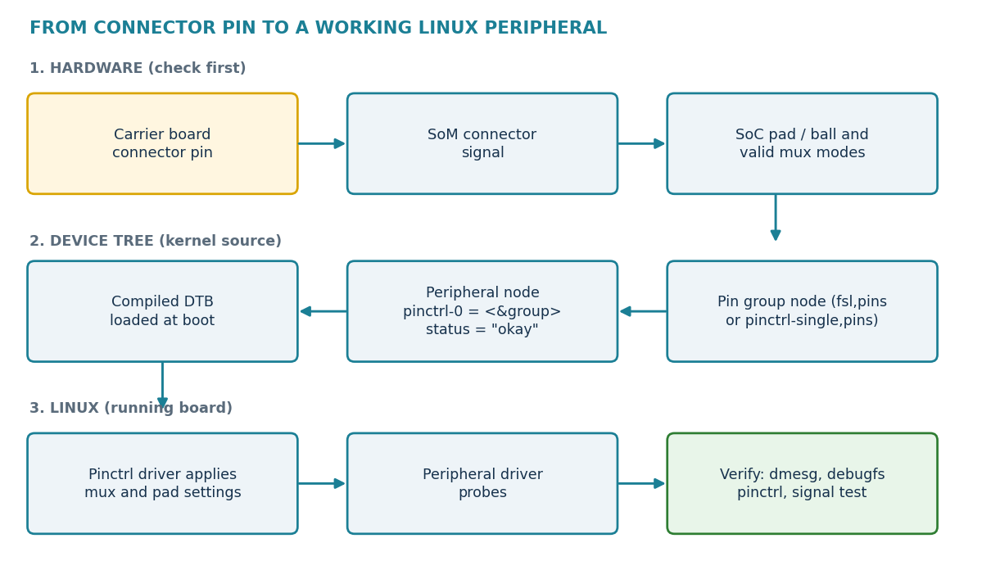
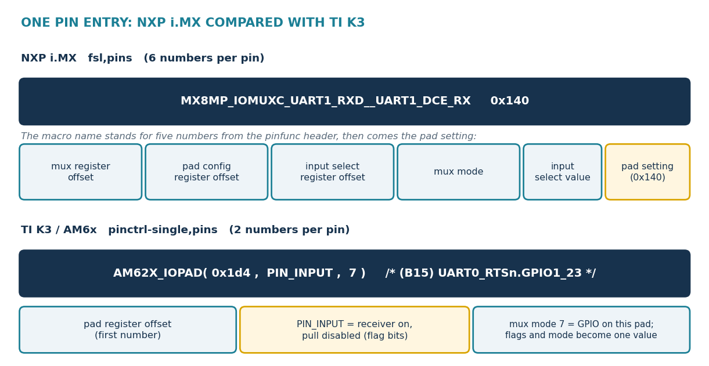

.. START:section:0:0
Objectives
==========

.. END:section:0:0

.. START:list:0:0:0

.. LIST_META: {"type": "bullet", "head": "", "items": ["Explain pinmux, pad configuration and the pinctrl group, and keep the three ideas apart.", "Trace a signal from a carrier connector pin to the SoC pad before changing any code.", "Read an NXP fsl,pins entry and a TI pinctrl-single,pins entry.", "Find the pin function headers, drivers and bindings in a PHYTEC kernel tree.", "Connect a pin group to a peripheral node with pinctrl-0.", "Verify the result on a running board, and recognise common pinmux faults."]}

- Explain pinmux, pad configuration and the pinctrl group, and keep the three ideas apart.
- Trace a signal from a carrier connector pin to the SoC pad before changing any code.
- Read an NXP fsl,pins entry and a TI pinctrl-single,pins entry.
- Find the pin function headers, drivers and bindings in a PHYTEC kernel tree.
- Connect a pin group to a peripheral node with pinctrl-0.
- Verify the result on a running board, and recognise common pinmux faults.

.. END:list:0:0:0

.. START:section:0:1
Pinmux Concepts
===============

.. END:section:0:1

.. START:main_content:0:1
A processor package has physical pads. Most pads can connect to several internal functions, such as UART, SPI, I²C, PWM or GPIO. Pin multiplexing (pinmux) chooses one of them for each pad. Only one function normally owns a pad at a time.

.. END:main_content:0:1

.. START:table:0:1:0

.. csv-table:: Table 1. Three ideas to keep separate
   :header: "Idea", "Meaning", "Where it is written"
   :align: center
   :class: align-center

   "Pinmux", "Selects which internal function is connected to a pad.", "Pin function macro in the pin group"
   "Pad configuration", "Sets electrical behaviour such as pull-up or pull-down, drive strength and input enable.", "A value in the pin group (BSP-13)"
   "Device tree link", "Tells Linux which pin group a device uses.", "pinctrl-names and pinctrl-0 in the device node"

.. END:table:0:1:0

A pin group is a named node that lists the pins of one function, for example the TX and RX pads of one UART. A peripheral node refers to the group, and the kernel pin-control driver applies the settings when the device is used.

.. START:image:0:1:11

   Figure 1. Path from a connector pin to a working Linux peripheral

.. END:image:0:1:11

|

.. START:tip:0:1:2

.. tip::

   | **One sentence to remember**
   | Pinmux chooses the signal, pad configuration sets the electrical behaviour, and the device tree connects that state to the Linux device.

.. END:tip:0:1:2

Trace the PHYTEC Hardware Path First
~~~~~~~~~~~~~~~~~~~~~~~~~~~~~~~~~~~~

A pin in the processor documentation is only the start. On a PHYTEC board the signal must also pass through the SoM connector, reach the carrier connector you want, and not already belong to another component.

.. START:table:0:1:4

.. csv-table:: Table 2. Checks before changing a pin
   :header: "Check", "Question", "Where to look"
   :align: center
   :class: align-center

   "Product and revision", "Which SoM and carrier revision do you have?", "Product label, release notes"
   "Connector pin", "Which carrier connector pin do you need?", "Hardware manual, schematic"
   "SoM signal", "Which SoM connector signal carries it?", "Hardware manual pinout table"
   "SoC pad", "Which processor pad does that signal reach, and which mux modes does it offer?", "PHYTEC pinmux tool, SoC reference manual"
   "Electrical level", "Is it 1.8 V, 3.3 V, open drain, or behind a transceiver or level shifter?", "Schematic"
   "Other users", "Is the pad used by boot, storage, Ethernet, camera or another device?", "Board .dts, SoM .dtsi, release notes"

.. END:table:0:1:4

.. START:warning:0:1:5

.. warning::

   | **A valid SoC function is not a valid board connection**
   | The SoC may support a function on a pad that the PHYTEC board routes to eMMC, a boot strap or a transceiver. Do not change a pin only because the SoC documentation allows it. The hardware manual, the schematic, the device tree and a test on the real board must agree.

.. END:warning:0:1:5

Where Pinmux Definitions Live in the Kernel
~~~~~~~~~~~~~~~~~~~~~~~~~~~~~~~~~~~~~~~~~~~

The mux functions and pad register addresses are defined in vendor headers, the pin groups are in the board and SoM device trees, and the kernel driver applies them. The paths below were confirmed in the supplied trees.

.. START:table:0:1:7

.. csv-table:: Table 3. Pinmux files in a PHYTEC kernel tree
   :header: "Platform", "Pin function header", "Pin controller driver", "Pin groups are in"
   :align: center
   :class: align-center

   "i.MX 8M Plus", "arch/arm64/boot/dts/freescale/imx8mp-pinfunc.h", "drivers/pinctrl/freescale/pinctrl-imx.c with the i.MX 8M driver", "imx8mp-phycore-som.dtsi, imx8mp-phyboard-pollux-rdk.dts"
   "i.MX 6UL", "arch/arm/boot/dts/nxp/imx/imx6ul-pinfunc.h (older trees: arch/arm/boot/dts/imx6ul-pinfunc.h)", "drivers/pinctrl/freescale/pinctrl-imx.c", "imx6ul-phytec-phycore-som.dtsi and the carrier files"
   "AM62x, AM64x", "arch/arm64/boot/dts/ti/k3-pinctrl.h", "drivers/pinctrl/pinctrl-single.c", "k3-am62-phycore-som.dtsi, k3-am625-phyboard-lyra-rdk.dts"
   "AM335x", "include/dt-bindings/pinctrl/am33xx.h", "drivers/pinctrl/pinctrl-single.c", "am335x-phycore-som.dtsi, am335x-phycore-rdk.dts"

.. END:table:0:1:7

Binding documents that describe each format are in Documentation/devicetree/bindings/pinctrl/. Use these searches to locate the files in your own tree:

.. START:code:0:1:9

.. code-block:: console

   $ find . -name "*pinfunc.h" -o -name "k3-pinctrl.h" | grep -Ei "imx8mp|imx6ul|k3-pinctrl"
   $ ls Documentation/devicetree/bindings/pinctrl | grep -Ei "imx|single"
   $ grep -n "pinctrl_uart1" arch/arm64/boot/dts/freescale/imx8mp-phycore-som.dtsi
   $ grep -n "pinctrl-single,pins" arch/arm64/boot/dts/ti/k3-am62-phycore-som.dtsi

.. END:code:0:1:9

.. START:tip:0:1:10

.. tip::

   | The header is the list of choices
   | A pin function header lists every function a pad can take. It does not tell you which one the PHYTEC board uses. The board device tree shows the choice that is actually made.

.. END:tip:0:1:10

.. START:section:0:2
NXP i.MX Pinmux
===============

.. END:section:0:2

.. START:main_content:0:2
NXP i.MX pin groups live as child nodes of the iomuxc node and use the fsl,pins property. Each entry has six numbers. The first five come from one pin function macro in the pinfunc header, and the last is the pad setting.

.. END:main_content:0:2

.. START:code:0:2:0

.. code-block:: bash

   &iomuxc {
   	pinctrl_uart1: uart1grp {
   		fsl,pins = <
   			MX8MP_IOMUXC_UART1_RXD__UART1_DCE_RX	0x140
   			MX8MP_IOMUXC_UART1_TXD__UART1_DCE_TX	0x140
   		>;
   	};
   };

.. END:code:0:2:0

PHYTEC explains pin muxing in its i.MX 8M Plus BSP manual with a UART1 group of this form. Compare it with the exact source of your release, because names and values can differ.

.. START:table:0:2:2

.. csv-table:: Table 4. How to read one NXP pin entry
   :header: "Part", "Meaning"
   :align: center
   :class: align-center

   "MX8MP_IOMUXC_UART1_RXD__UART1_DCE_RX", "The pad (UART1_RXD) and the function selected on it (UART1_DCE_RX). The macro expands to five numbers."
   "Number 1: mux register offset", "Register that selects the function of the pad."
   "Number 2: pad configuration register offset", "Register that holds the electrical settings."
   "Number 3: input select register offset", "Register used when the function needs an input daisy-chain selection. The value is 0 when none is needed."
   "Number 4: mux mode", "Alternate-function number written to the mux register."
   "Number 5: input select value", "Value for the input select register."
   "Number 6: pad setting (0x140)", "Pad configuration value, written by hand next to the macro. Its bits are defined in the reference manual of the same SoC (BSP-13)."

.. END:table:0:2:2

As an example of the five numbers, one i.MX 8M Mini pin function in the NXP community reads 0x1B0 0x418 0x4F4 0x4 0x2: mux register 0x1B0, pad register 0x418, input select register 0x4F4, mux mode 4 and input value 2.

.. START:image:0:2:5

   Figure 2. One pin entry on NXP i.MX (six numbers) and on TI K3 (two numbers).

.. END:image:0:2:5

|

.. START:warning:0:2:4

.. warning::

   | **Macro names differ between i.MX families**
   | On i.MX 8M Plus the function is separated from the pad by two underscores (..._UART1_RXD__UART1_DCE_RX). Other families may use one, for example the kernel binding example for i.MX 8M Mini reads MX8MM_IOMUXC_UART1_RXD_UART1_DCE_RX. [4] Always copy the name from the pinfunc header of your own SoC and search it with grep. A pad value such as 0x140 is not a universal number.

.. END:warning:0:2:4

.. START:section:0:3
TI Pinmux
=========

.. END:section:0:3

.. START:main_content:0:3
TI K3 devices (AM62x, AM62Ax, AM64x and others) use the generic pinctrl-single driver. Each pin is a pair of numbers inside pinctrl-single,pins, written with an IOPAD macro from the SoC family.

.. END:main_content:0:3

.. START:code:0:3:0

.. code-block:: console

   gpio_keys_pins_default: gpio-keys-default-pins {
   	pinctrl-single,pins = <
   		AM62X_IOPAD(0x1d4, PIN_INPUT, 7) /* (B15) UART0_RTSn.GPIO1_23 */
   	>;
   };
    
   main_mmc1_pins_default: main-mmc1-default-pins {
   	pinctrl-single,pins = <
   		AM62X_IOPAD(0x23c, PIN_INPUT_PULLUP, 0) /* (A21) MMC1_CMD */
   	>;
   };

.. END:code:0:3:0

Both lines come from the PHYTEC phyBOARD-Lyra AM625 board file in the Linux kernel. [6] The comment names the ball, the pad and the selected function.

.. START:table:0:3:2

.. csv-table:: Table 5. How to read one TI K3 pin entry
   :header: "Part", "Meaning"
   :align: center
   :class: align-center

   "AM62X_IOPAD(...)", "Macro of the SoC family. AM62x uses AM62X_IOPAD and AM62X_MCU_IOPAD, AM62Ax uses AM62AX_IOPAD, AM64x uses AM64X_IOPAD and AM64X_MCU_IOPAD, and J721S2 (AM68x) uses J721S2_IOPAD and J721S2_WKUP_IOPAD. The macro masks the offset with 0x1fff and expands to two numbers."
   "First argument (0x1d4)", "Offset of the pad configuration register inside the pin controller. It is not a connector pin number. Example: on AM62x the main pin controller starts at 0xF4000, so offset 0x1B4 is register 0xF41B4."
   "Second argument (PIN_INPUT)", "Flag combination that sets receiver, pull and pull type bits."
   "Third argument (7)", "Mux mode of the pad. Mode numbers differ from pad to pad. Here mode 7 selects GPIO."
   "Pin controller node", "Pin groups of AM62x are placed in &main_pmx0 (main domain) or &mcu_pmx0 (MCU domain), matching the IOPAD macro used."

.. END:table:0:3:2

The flag names are defined in the TI K3 pinctrl header. The values below are the bit positions and combinations that form the second number. [

.. START:table:0:3:4

.. csv-table:: Table 6. TI K3 pad flag macros
   :header: "Macro", "Definition"
   :align: center
   :class: align-center

   "Bit positions", "Pull disable at bit 16, pull type select at bit 17, receiver (input) enable at bit 18"
   "PIN_OUTPUT", "Input disabled, pull disabled"
   "PIN_OUTPUT_PULLUP, PIN_OUTPUT_PULLDOWN", "Input disabled, pull enabled with the chosen direction"
   "PIN_INPUT", "Input enabled, pull disabled"
   "PIN_INPUT_PULLUP, PIN_INPUT_PULLDOWN", "Input enabled, pull enabled with the chosen direction"

.. END:table:0:3:4

.. START:note:0:3:5

.. note::

   | **AM335x also uses pinctrl-single**
   | AM335x pin groups use the same driver with macros from include/dt-bindings/pinctrl/am33xx.h, so the macro names and arguments differ from K3. Read the header of your own tree before you write an entry.

.. END:note:0:3:5

.. START:warning:0:3:6

.. warning::

   | **Do not copy entries between vendors or SoCs**
   | An NXP fsl,pins entry does not work on TI, and an AM62X_IOPAD line does not work on AM64x or AM68x. Offsets, pad names and mux modes belong to one SoC. Take every entry from a PHYTEC board file or from a tool set to the same SoC.

.. END:warning:0:3:6

.. START:section:0:4
NXP and TI Compared
===================

.. END:section:0:4

.. START:table:0:4:0

.. csv-table:: Table 7. Pinmux in PHYTEC device trees: NXP i.MX compared with TI K3
   :header: "Topic", "NXP i.MX", "TI K3 (AM6x)"
   :align: center
   :class: align-center

   "Pin group property", "fsl,pins", "pinctrl-single,pins"
   "Numbers per pin", "Six: five from the macro plus the pad setting", "Two: offset and value (flags OR mode)"
   "Where functions are listed", "imx*-pinfunc.h header for the SoC", "k3-pinctrl.h macros plus the TI technical reference manual"
   "Pad electrical settings", "Hex value written next to the macro", "Flag macros such as PIN_INPUT_PULLUP"
   "Pin controller node", "&iomuxc", "&main_pmx0, &mcu_pmx0 and similar"
   "Pin controller driver", "pinctrl-imx family", "pinctrl-single"
   "Main risk", "Wrong function macro or wrong pad value", "Wrong offset or wrong mux mode"
   "Link to the device", "pinctrl-names, pinctrl-0", "pinctrl-names, pinctrl-0"

.. END:table:0:4:0

.. START:section:0:5
Connect a Pin Group to a Device
===============================

.. END:section:0:5

.. START:main_content:0:5
A pin group has no effect until a device node refers to it. The reference uses the same properties on NXP and TI.

.. END:main_content:0:5

.. START:code:0:5:0

.. code-block:: console

   &uart1 {
   	pinctrl-names = "default";
   	pinctrl-0 = <&pinctrl_uart1>;
   	status = "okay";
   };

.. END:code:0:5:0

.. START:table:0:5:1

.. csv-table:: Table 8. Pinctrl properties of a device node
   :header: "Property", "Meaning"
   :align: center
   :class: align-center

   "pinctrl-names", "Names of the states, for example default, sleep or gpio."
   "pinctrl-0", "Pin group or groups used in the first state. More than one group can be listed."
   "pinctrl-1", "Pin group of the second state, matching the second name."
   "status", "okay enables the node. A disabled node does not apply its pin groups."

.. END:table:0:5:1

.. START:tip:0:5:2

.. tip::

   | **A defined group is not an applied group**
   | If the group exists but no enabled device node refers to it, Linux never applies it. The reverse also fails: a node that refers to a group that does not exist stops the device from probing.

.. END:tip:0:5:2

.. START:note:0:5:3

.. note::

   | **Board files override shared files**
   | The SoC file defines the controller, the SoM file defines the module pins, and the board file may override a node with the board wiring. Change the pin group in the file that owns the hardware, as described in BSP-03.

.. END:note:0:5:3

.. START:section:0:6
Find Pin Functions in the Source
================================

.. END:section:0:6

.. START:main_content:0:6
Work from the board toward the header. Start with the node, follow the group, then check the possible functions.

.. END:main_content:0:6

.. START:code:0:6:0

.. code-block:: console

   # 1. Which group does the peripheral use?
   $ grep -n -A4 "&uart1" arch/arm64/boot/dts/freescale/imx8mp-phyboard-pollux-rdk.dts
    
   # 2. What does the group contain?
   $ grep -rn -A6 "pinctrl_uart1: " arch/arm64/boot/dts/freescale/imx8mp-phycore-som.dtsi
    
   # 3. What can this pad do?
   $ grep -n "MX8MP_IOMUXC_UART1_RXD" arch/arm64/boot/dts/freescale/imx8mp-pinfunc.h
    
   # TI: list pin groups and macros of a board
   $ grep -n "AM62X_IOPAD\|pinctrl-single,pins" arch/arm64/boot/dts/ti/k3-am625-phyboard-lyra-rdk.dts
   $ grep -n "define PIN_\|define AM62X" arch/arm64/boot/dts/ti/k3-pinctrl.h

.. END:code:0:6:0

A group can be defined in the SoM file while the node is enabled in the board file. If the first search finds nothing, search the include chain from BSP-03.

.. START:tip:0:6:2

.. tip::

   | **Search for a pad to find conflicts**
   | Search all device-tree files for the pad name. If two enabled pin groups contain the same pad, one of them must be disabled or changed.

.. END:tip:0:6:2

.. START:section:0:7
Pinmux Tools
============

.. END:section:0:7

.. START:main_content:0:7
Three tools help to choose pins. Their details are in BSP-10, BSP-11 and BSP-12. None of them replaces the check of the real board and the device tree.

.. END:main_content:0:7

.. START:table:0:7:0

.. csv-table:: Table 9. Pinmux tools and what they give you
   :header: "Tool", "Gives you", "Link to the Linux device tree"
   :align: center
   :class: align-center

   "NXP Config Tools for i.MX (Pins tool)", "Pin routing and electrical settings for supported i.MX devices.", "Compare the export with the existing board file. Take only the pin entries you need. Check the export options of your tool version."
   "TI SysConfig (PinMux)", "Valid pin combinations for AM6x devices. TI states that it configures the SoC muxing only, not the board. It can produce a pinmux DTSI that replaces the pin nodes of a custom board device tree.", "Check that the pad names and macros match the PHYTEC board file. For PHYTEC boards follow the PHYTEC BSP instructions."
   "PHYTEC Pinmuxing Tool", "Select SoM and carrier, then view connector or physical pinout of the chosen interfaces.", "Shows which connector pins an interface uses on the real board. Make the matching change in the device tree."

.. END:table:0:7:0

.. START:section:0:8
Example: Trace a UART on Two Boards
===================================

.. END:section:0:8

.. START:main_content:0:8
The method is the same for NXP and TI.

.. END:main_content:0:8

.. START:list:0:8:0

.. LIST_META: {"type": "bullet", "head": "i.MX 8M Plus (phyBOARD-Pollux)", "items": ["Find the UART connector signal in the hardware manual and schematic, and note the voltage level.", "Find the UART node in imx8mp-phyboard-pollux-rdk.dts (for example &uart1) and read its pinctrl-0.", "Open the pin group (for example pinctrl_uart1) and read the two fsl,pins entries.", "Search each macro in imx8mp-pinfunc.h and check the pad and the function.", "Check that the pad is not used by another enabled group.", "Check the pad value against the reference manual if you change it (BSP-13)."]}

.. container:: spx-list-head

    **i.MX 8M Plus (phyBOARD-Pollux)**

- Find the UART connector signal in the hardware manual and schematic, and note the voltage level.
- Find the UART node in imx8mp-phyboard-pollux-rdk.dts (for example &uart1) and read its pinctrl-0.
- Open the pin group (for example pinctrl_uart1) and read the two fsl,pins entries.
- Search each macro in imx8mp-pinfunc.h and check the pad and the function.
- Check that the pad is not used by another enabled group.
- Check the pad value against the reference manual if you change it (BSP-13).

.. END:list:0:8:0

.. START:list:0:8:1

.. LIST_META: {"type": "bullet", "head": "AM62x (phyBOARD-Lyra)", "items": ["Find the signal in the hardware manual and schematic.", "Find the node in k3-am625-phyboard-lyra-rdk.dts or the shared carrier file, and read its pinctrl-0.", "Open the group and read each AM62X_IOPAD(offset, flags, mode) line and its comment.", "Compare the ball and pad name in the comment with the SoM and carrier signal.", "Check that the flags suit the signal: input enable for inputs and pull direction for pull-ups.", "Check that another enabled group does not use the same offset."]}

.. container:: spx-list-head

    **AM62x (phyBOARD-Lyra)**

- Find the signal in the hardware manual and schematic.
- Find the node in k3-am625-phyboard-lyra-rdk.dts or the shared carrier file, and read its pinctrl-0.
- Open the group and read each AM62X_IOPAD(offset, flags, mode) line and its comment.
- Compare the ball and pad name in the comment with the SoM and carrier signal.
- Check that the flags suit the signal: input enable for inputs and pull direction for pull-ups.
- Check that another enabled group does not use the same offset.

.. END:list:0:8:1

.. START:tip:0:8:2

.. tip::

   | **I²C lines need pull-ups**
   | I²C lines normally need pull-ups, which the board or the external device may already provide. Check the schematic before you add an internal pull-up.

.. END:tip:0:8:2

.. START:section:0:9
Verify Pinmux on a Running Board
================================

.. END:section:0:9

.. START:main_content:0:9
Start by confirming that the expected device tree is running (see BSP-03). Then use the kernel pinctrl debug files if the kernel provides them.

.. END:main_content:0:9

.. START:code:0:9:0

.. code-block:: console

   $ dmesg | grep -Ei "pinctrl|pinmux|uart|spi|i2c" | head -n 40
   $ mount | grep debugfs || mount -t debugfs none /sys/kernel/debug
   $ ls /sys/kernel/debug/pinctrl/
   $ cat /sys/kernel/debug/pinctrl/*/pinmux-pins | head -n 60
   $ cat /sys/kernel/debug/pinctrl/*/pinmux-functions | head -n 40

.. END:code:0:9:0

.. START:table:0:9:1

.. csv-table:: Table 10. Pinctrl debug files
   :header: "File", "What it shows"
   :align: center
   :class: align-center

   "pinmux-pins", "Each pin and its owner. MUX UNCLAIMED means no device has claimed the mux function of that pin."
   "pinmux-functions", "Functions known to the pin controller and the groups they use."
   "pins, pingroups", "Pin and group lists of the controller."
   "pinconf-pins", "Pad configuration of each pin, where the driver supports it."

.. END:table:0:9:1

.. START:list:0:9:2

.. LIST_META: {"type": "bullet", "head": "", "items": ["The debug files depend on the kernel configuration and the pin controller driver. Missing files are not a pinmux error. Use the live device tree, the log and a signal test instead.", "A clean log does not prove that the voltage, the routing or the external device is correct. Measure the signal with a logic analyser or a loopback test."]}

- The debug files depend on the kernel configuration and the pin controller driver. Missing files are not a pinmux error. Use the live device tree, the log and a signal test instead.
- A clean log does not prove that the voltage, the routing or the external device is correct. Measure the signal with a logic analyser or a loopback test.

.. END:list:0:9:2

.. START:warning:0:9:3

.. warning::

   | **Do not write to pinctrl debugfs on a production board**
   | Debugfs is for diagnosis. A reviewed device-tree change is the way to change a pin permanently.

.. END:warning:0:9:3

.. START:section:0:10
Safe Pinmux Workflow
====================

.. END:section:0:10

.. START:list:0:10:0

.. LIST_META: {"type": "bullet", "head": "", "items": ["Confirm SoM, carrier, revision, BSP release and kernel tag.", "Trace the signal from the connector to the SoC pad using the hardware manual, schematic and PHYTEC pinmux tool.", "Check the valid functions of the pad in the pinfunc header or the technical reference manual.", "Search the device tree for other users of the pad and for boot-critical pads.", "Edit the pin group in the correct file, using the macro format of your SoC.", "Refer to the group from the correct node and enable the node.", "Build the DTB and read the compiler messages (BSP-02, BSP-03).", "Deploy the matching DTB or FIT image and keep the previous one for rollback.", "Verify with dmesg, the debugfs files and a signal test.", "Save the change as a patch with the board name, release and test result."]}

- Confirm SoM, carrier, revision, BSP release and kernel tag.
- Trace the signal from the connector to the SoC pad using the hardware manual, schematic and PHYTEC pinmux tool.
- Check the valid functions of the pad in the pinfunc header or the technical reference manual.
- Search the device tree for other users of the pad and for boot-critical pads.
- Edit the pin group in the correct file, using the macro format of your SoC.
- Refer to the group from the correct node and enable the node.
- Build the DTB and read the compiler messages (BSP-02, BSP-03).
- Deploy the matching DTB or FIT image and keep the previous one for rollback.
- Verify with dmesg, the debugfs files and a signal test.
- Save the change as a patch with the board name, release and test result.

.. END:list:0:10:0

.. START:danger:0:10:1

.. danger::

   | A boot-critical pin can stop the board
   | Changing the mux of a pad used for eMMC, SD, boot straps, reset or the console can leave the board unable to start, even if Linux still builds. Keep a known-good image and a serial console, and check the schematic for pull resistors on strap pins before you change them.

.. END:danger:0:10:1

.. START:section:0:11
Common Pinmux Problems
======================

.. END:section:0:11

.. START:table:0:11:0

.. csv-table:: Table 11. Symptoms and first checks
   :header: "Symptom", "Likely cause", "First check"
   :align: center
   :class: align-center

   "The device does not appear.", "Node disabled, wrong DTB or missing driver.", "status, live model, dmesg."
   "The device appears but signals do not work.", "Wrong function, mux mode or routing.", "Schematic, pin group, oscilloscope."
   "The build fails on a macro.", "Macro from another SoC, a typo, or a missing include.", "Search the macro in the SoC header."
   "Two devices conflict.", "The same pad is in two enabled groups.", "Search all device-tree files for the pad."
   "The change has no effect.", "An old DTB or FIT image is loaded.", "Boot configuration and deployed files."
   "UART receives but cannot send.", "TX and RX swapped, wrong direction or flags, or a transceiver.", "Group entries, schematic."
   "I²C bus stuck.", "Missing pull-up, wrong voltage or a device holding the line.", "Hardware levels before changing the device tree."
   "The signal works only at low speed.", "Drive strength, slew rate or signal integrity.", "Pad settings (BSP-13) and carrier layout."
   "The board does not boot after a change.", "A boot-critical pad was reassigned.", "Restore the known-good DTB and review boot and storage pads."

.. END:table:0:11:0

.. START:section:0:12
Pinmux Checklist
================

.. END:section:0:12

.. START:main_content:0:12
| Board, revision, BSP release and kernel tag recorded.
| Connector, SoM signal and SoC pad traced and written down.
| Voltage level and other users of the pad checked.
| Valid function found in the pinfunc header or technical reference manual.
| Pin group written in the macro format of the right SoC.
| Node refers to the group and is enabled.
| DTB builds without warnings and the right artifact is deployed.
| Debug files, log and signal test checked on the board.
| Patch saved with the test result and a way back.

.. END:main_content:0:12

.. START:section:0:13
Glossary and References
=======================

.. END:section:0:13

.. START:table:0:13:0

.. csv-table:: Table 12. Terms used in this guide
   :header: "Term", "Meaning"
   :align: center
   :class: align-center

   "Pad / ball", "The physical processor connection point. A ball is a pad on a BGA package."
   "Mux mode", "The alternate-function number selected on a pad."
   "Pad configuration", "Electrical settings of a pad such as pull, drive strength and input enable."
   "Pinctrl", "The Linux pin-control subsystem and its device-tree properties."
   "Pin group", "A named node that lists pins and their settings."
   "IOMUXC", "The NXP i.MX pin control block and its device-tree node."
   "IOPAD", "TI K3 macro that builds a pad register entry."
   "Daisy chain", "NXP input select register that chooses which pad feeds an input."
   "SysConfig", "TI configuration tool with a PinMux function."

.. END:table:0:13:0

References
~~~~~~~~~~

[1] Linux kernel: `fsl,imx8mq-pinctrl binding <https://kernel.org/doc/Documentation/devicetree/bindings/pinctrl/fsl%2Cimx8mq-pinctrl.txt>`_ — Six integers per pin; five from the macro, the last is CONFIG.

[2] Linux kernel: `fsl,imx8mm-pinctrl binding <https://www.kernel.org/doc/Documentation/devicetree/bindings/pinctrl/fsl%2Cimx8mm-pinctrl.txt>`_ — Example UART1 group with pad value 0x140.

[3] NXP Community: `i.MX8M Mini UART Port <https://community.nxp.com/t5/i-MX-Processors/i-MX8M-Mini-UART-Port/td-p/950796>`_ — Shows how a pin function macro expands to five numbers.

[4] Variscite: `i.MX device tree pinmux settings <https://variscite.com/blog/i-mx-device-tree-pinmux-settings/>`_ — Pin function headers per i.MX SoC.

[5] Toradex: `Pinmuxing AM6X based modules <https://developer.toradex.com/software/linux-resources/device-tree/pinmuxing-guide/pinmuxing-with-am6x-based-modules/>`_ — pinctrl-single,pins, IOPAD and address calculation.

[6] Linux kernel commit: `k3-am625-phyboard-lyra audio codec <https://git.zx2c4.com/wireguard-linux/commit/?id=28c0cf16b3083566cd96b60d3cedbe69b79a8e5b>`_ — PHYTEC Lyra pin group lines.

[7] TI K3 pinctrl header: `k3-pinctrl.h <https://git.beagleboard.org/beagleboard/BeagleBoard-DeviceTrees/-/blame/c84eb18cf256f2affcf596616c6fbac1589a4b35/src/arm64/ti/k3-pinctrl.h>`_ — Flag macros and IOPAD macros.

[8] Toradex: `Pinmuxing AM6X based modules <https://developer.toradex.com/software/linux-resources/device-tree/pinmuxing-guide/pinmuxing-with-am6x-based-modules/>`_ — Main pin controller base and register example.

[9] Linux: `Pin control subsystem <https://docs.kernel.org/driver-api/pin-control.html>`_ — pinctrl-names and pinctrl-0 usage.

[10] NXP: `Config Tools for i.MX <https://mcuxpresso.nxp.com/pinsimx/latest/introduction.html>`_ — Pins tool for i.MX devices.

[11] TI: `SPRADD1A – Booting the Linux Kernel <https://www.ti.com/document-viewer/lit/html/SPRADD1A/GUID-55BA64B3-F619-439B-9189-1ECA528772AE>`_ — SysConfig pinmux DTSI for a custom board device tree.

[12] TI E2E: `AM625 McASP configuration and GPIO mux <https://e2e.ti.com/support/processors-group/processors/f/processors-forum/1221435/am625-mcasp-configuration---gpio-mux>`_ — SysConfig covers SoC muxing only.

[13] PHYTEC: `Pinmuxing Tool <https://pinmux.phytec.com/>`_ — Select SoM and carrier board, interfaces, connector and physical pinouts.

[14] Toradex Community: `AM62 pinmux-pins debug output <https://community.toradex.com/t/am62-verdin-gpio-pins-remain-mux-unclaimed-gpio-unclaimed-even-after-dt-changes-and-hogging/29070>`_ — MUX UNCLAIMED output in pinmux-pins.

[15] PHYTEC BSP documentation: `doc-bsp-yocto <https://github.com/phytec/doc-bsp-yocto>`_ — PHYTEC pin-muxing sections for i.MX BSPs.
