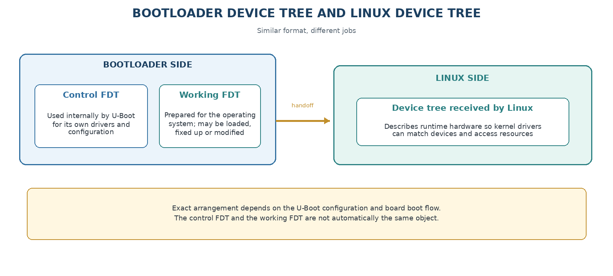
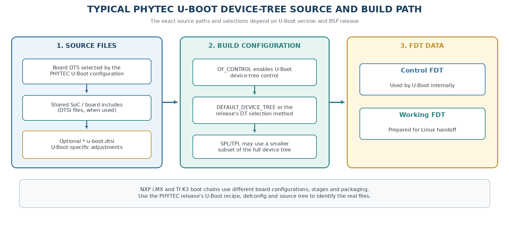
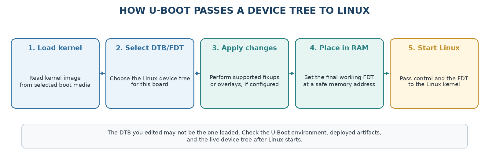

.. START:section:1:1
1. Why does the bootloader use a device tree?
=============================================

.. END:section:1:1

.. START:main_content:1:1
Bootloader Device Tree Configuration for PHYTEC BSP workflows. This document explains why bootloaders use a device tree, how bootloader DT and Linux DT differ, where PHYTEC U-Boot DT sources are typically located, and how the DT handoff to Linux works.

A bootloader may need hardware information before Linux starts. It can use a device tree to describe memory, storage, buses, regulators, clocks, Ethernet, boot devices and other board information. The bootloader can also load or modify a device tree and pass it to Linux.

.. END:main_content:1:1

.. START:table:1:1:1

.. csv-table:: Table 1  -  Bootloader DT and Linux DT
   :header: "Question", "Bootloader device tree", "Linux device tree"
   :align: center

   "Main user", "SPL, TF-A, U-Boot or another boot stage", "Linux kernel"
   "Main purpose", "Early initialization, boot-device access and handoff", "Driver binding and runtime hardware description"
   "Typical source", "U-Boot arch/*/dts/ and board files", "Linux arch/*/boot/dts/ and board files"
   "Typical binary", "U-Boot-controlled DTB or embedded control FDT", "DTB passed to the kernel"
   "Change risk", "Can stop the board before Linux", "Can stop or disable a Linux peripheral"

.. END:table:1:1:1

.. START:image:1:1:1

   Figure-1 Bootloader vs Linux Device Tree

.. END:image:1:1:1

|

.. START:table:1:1:2

.. csv-table::
.. tip::

   The two trees may look similar, but they are not automatically interchangeable. Always edit the tree selected by the component you are changing.

.. END:table:1:1:2

.. START:section:1:2
2. What is an FDT?
==================

.. END:section:1:2

.. START:main_content:1:2
FDT means Flattened Device Tree. It is the compiled binary form of a device tree, commonly called a DTB. U-Boot can have a device tree for its own control data and can also carry a separate working device tree that it passes to Linux.

The exact names and memory locations depend on the U-Boot configuration. U-Boot documentation calls out device-tree control as a configuration feature, so a particular build may use an embedded control tree, an external tree or both.

.. END:main_content:1:2

.. START:table:1:2:1

.. csv-table:: Table 2  -  Device-tree terms in bootloader work
   :header: "Term", "Simple meaning"
   :align: center

   "DTS", "Readable device-tree source file"
   "DTSI", "Reusable device-tree include file"
   "DTB/FDT", "Compiled binary device tree"
   "Control FDT", "Device tree used internally by U-Boot itself"
   "Working FDT", "Device tree that U-Boot prepares for the operating system"
   "Overlay", "Optional change applied to a base tree when the boot flow supports it"

.. END:table:1:2:1

.. START:image:1:2:2

   Figure-2 PHYTEC U-Boot Device Tree Path

.. END:image:1:2:2

|

.. START:section:1:3
3. When should you edit the bootloader tree?
============================================

.. END:section:1:3

.. START:main_content:1:3
Edit the bootloader device tree only when the hardware description is needed by the bootloader or when the bootloader must pass a corrected description to Linux. Many Linux-only peripheral changes belong in the Linux DTS instead.

.. END:main_content:1:3

.. START:table:1:3:1

.. csv-table:: Table 3  -  Choose the correct tree
   :header: "Your task", "Usually edit first"
   :align: center

   "Make U-Boot find an early storage or regulator device", "Bootloader DTS/DTSI and bootloader configuration"
   "Change a Linux sensor or peripheral node", "Linux DTS/DTSI"
   "Change Linux pinctrl for a peripheral", "Linux DTS/DTSI; see BSP-04"
   "Change the DTB passed to Linux", "Linux DTS/DTSI and bootloader DTB selection"
   "Change U-Boot's internal driver data", "U-Boot control device tree and U-Boot source/config"
   "Change boot commands or environment", "U-Boot environment/configuration, not necessarily DTS"

.. END:table:1:3:1

.. START:table:1:3:2

.. csv-table::
.. warning::

   Changing a bootloader DTS does not automatically change the Linux device tree. Conversely, changing only a Linux DTS may not fix a device that U-Boot must access before Linux.

.. END:table:1:3:2

.. START:image:1:3:3

   Figure-3 Bootloader DT Handoff to Linux

.. END:image:1:3:3

|

.. START:section:1:4
4. Find bootloader DTS/DTSI files
=================================

.. END:section:1:4

.. START:main_content:1:4
The bootloader and Linux source trees normally have separate device-tree directories. Start from the bootloader repository and the board target named by the PHYTEC BSP manual.

::

   # From a U-Boot source tree
   $ find arch -path '*/dts/*' -type f \( -name '*.dts' -o -name '*.dtsi' \) | head -n 80
   $ grep -RIn 'phyboard\|phycore\|phyflex\|am62\|imx8' arch/*/dts board
   
   # Find configuration references
   $ grep -RIn 'DEFAULT_DEVICE_TREE\|OF_CONTROL\|OF_SEPARATE\|OF_EMBED' .

Directory names differ between U-Boot releases. Use find, the PHYTEC BSP recipe and the documented defconfig to identify the real path.

.. END:main_content:1:4

.. START:table:1:4:1

.. csv-table:: Table 4  -  Where to look in a bootloader source tree
   :header: "Location", "What it may contain"
   :align: center

   "arch/arm/dts/ or arch/arm64/dts/", "SoC and board device-tree source"
   "board/<vendor>/<board>/", "Board C code, board configuration and related files"
   "configs/", "U-Boot defconfig files"
   "dts/upstream/", "Some U-Boot versions keep imported or upstream DTS files here"
   "tools/ and binman files", "Boot-image packaging and generated artifact descriptions"

.. END:table:1:4:1

.. START:section:1:5
5. Trace the bootloader include chain
=====================================

.. END:section:1:5

.. START:main_content:1:5
A board DTS commonly includes a SoC DTSI and one or more shared files. Read the board file first, then follow each include until you understand the nodes needed by the boot stage.

::

   # Show includes and board identity
   $ grep -nE '^#include|model =|compatible =|status = ' arch/arm/dts/<board>.dts
   
   # Search for an included file or board name
   $ grep -RIn '<included-file-name>\|<board-name>' arch/arm/dts board configs

1. Find the board target named by the PHYTEC build instructions.

2. Open its DTS and list all #include files.

3. Identify the SoC, board and boot-critical nodes.

4. Check which nodes are enabled for the bootloader.

5. Check the U-Boot defconfig and device-tree selection.

6. Build the unmodified target before changing it.

.. END:main_content:1:5

.. START:table:1:5:1

.. csv-table::
.. tip::

   Do not assume the Linux board filename exists in U-Boot with the same path or name. Search the bootloader repository independently.

.. END:table:1:5:1

.. START:section:1:6
6. Understand U-Boot device-tree control
========================================

.. END:section:1:6

.. START:main_content:1:6
U-Boot can be built with device-tree control enabled. In that mode, U-Boot uses a device tree to describe its own devices and configuration. The exact Kconfig symbols and selection method depend on the U-Boot version.

::

   # Inspect a configured U-Boot build
   $ grep -E '^CONFIG_(OF_CONTROL|OF_SEPARATE|OF_EMBED|DEFAULT_DEVICE_TREE)=' build/.config
   $ grep -RIn 'CONFIG_DEFAULT_DEVICE_TREE\|CONFIG_OF_CONTROL' configs include

.. END:main_content:1:6

.. START:table:1:6:1

.. csv-table:: Table 5  -  U-Boot device-tree control concepts
   :header: "Concept", "What it means"
   :align: center

   "OF_CONTROL", "U-Boot uses device-tree data to control its devices"
   "Control FDT", "The tree U-Boot uses internally"
   "External FDT", "A DTB provided separately to the U-Boot build or boot flow"
   "Embedded FDT", "A DTB included in the U-Boot image"
   "Working FDT", "The tree U-Boot modifies or passes to Linux"

.. END:table:1:6:1

.. START:table:1:6:2

.. csv-table::
.. important::

   A configuration symbol may be renamed or handled differently in a newer U-Boot release. Read the configuration generated by your PHYTEC release instead of assuming every symbol exists.

.. END:table:1:6:2

.. START:section:1:7
7. Bootloader DTS and Linux DTS: what is different?
===================================================

.. END:section:1:7

.. START:main_content:1:7
Both trees use the Device Tree format, but they serve different software and may contain different nodes or properties. U-Boot may need only enough information to initialize storage and load Linux. Linux needs a complete runtime description for its drivers.

.. END:main_content:1:7

.. START:table:1:7:1

.. csv-table:: Table 6  -  Examples of information handled at each stage
   :header: "Bootloader may need", "Linux normally needs"
   :align: center

   "Boot storage and partitions", "Storage controller and partition-aware Linux drivers"
   "DDR/memory map", "Memory nodes and reserved-memory regions"
   "Serial console", "Console UART and Linux serial driver"
   "Ethernet for network boot", "MAC, PHY, clocks, reset, pinctrl and network driver"
   "Power needed for early boot", "Full regulator relationships for runtime drivers"

.. END:table:1:7:1

.. START:table:1:7:2

.. csv-table::
.. warning::

   Do not remove a Linux-only node from the Linux DT just because U-Boot does not use it. Do not add a bootloader-only property to Linux without checking its binding.

.. END:table:1:7:2

.. START:section:1:8
8. Select and inspect the DTB at the U-Boot prompt
==================================================

.. END:section:1:8

.. START:main_content:1:8
If the board reaches a U-Boot prompt, inspect the environment and FDT variables before changing anything. Exact variable names vary by PHYTEC release.

::

   $ => printenv fdtfile
   $ => printenv fdt_addr_r
   $ => printenv fdtcontroladdr
   $ => printenv bootcmd
   $ => printenv bootargs
   $ => bdinfo
   $ => fdt addr ${fdt_addr_r}
   $ => fdt header
   $ => fdt print /model
   $ => fdt print /compatible

Table7  -  Useful U-Boot FDT commands

.. END:main_content:1:8

.. START:table:1:8:1

.. csv-table:: Table 12 - Documentation details
   :header: "Command", "Purpose"
   :align: center

   "fdt addr <address>", "Select the FDT at a memory address"
   "fdt header", "Show FDT header and size information"
   "fdt print <path>", "Display nodes or properties"
   "fdt list <path>", "List child nodes and properties"
   "fdt resize", "Make room for supported FDT changes"
   "printenv fdtfile", "Show the selected Linux DTB name, when the environment uses it"

.. END:table:1:8:1

.. START:table:1:8:2

.. csv-table::
.. warning::

   Treat fdt set, fdt mknode, fdt rm and env save as changes to a live boot process. Use read-only commands first and do not save experimental values unless you have a recovery plan.

.. END:table:1:8:2

.. START:section:1:9
9. Check the DTB that Linux actually received
=============================================

.. END:section:1:9

.. START:main_content:1:9
The DTB selected by U-Boot may not be the same file you edited. After Linux boots, check the board model and live device tree.

::

   # On the running Linux board
   $ cat /proc/device-tree/model 2>/dev/null; echo
   $ tr '\0' '\n' < /proc/device-tree/compatible 2>/dev/null
   $ dtc -I fs -O dts -o running.dts /sys/firmware/devicetree/base
   $ grep -nE 'model|compatible|chosen|memory' running.dts | head -n 80

Compare the running model, bootloader fdtfile, deploy-directory DTB and source board file. If they disagree, stop and resolve the boot selection before debugging a hardware node.

.. END:main_content:1:9

.. START:section:1:10
10. Make a safe bootloader device-tree change
=============================================

.. END:section:1:10

.. START:main_content:1:10
Use the smallest possible change and keep the original image available. Typical changes include adding an early regulator, enabling a bootloader-accessible bus, correcting a storage node or selecting the correct board identity.

1. Confirm the change is required by the bootloader, not only by Linux.

2. Check the hardware manual and PHYTEC release notes.

3. Find the bootloader board DTS and include chain.

4. Read the binding or nearby working example.

5. Make one board-specific change.

6. Build the bootloader and inspect the generated artifact.

7. Test from a replaceable or recovery medium.

8. Inspect the U-Boot prompt and the Linux live DTB.

9. Run the boot and functional test.

.. END:main_content:1:10

.. START:table:1:10:1

.. csv-table:: Table 8  -  Examples of bootloader DT changes
   :header: "Change", "Why it may be needed"
   :align: center

   "Enable an early MMC or OSPI node", "Lets the bootloader read the next image from storage"
   "Describe an early regulator", "Provides power needed before Linux starts"
   "Correct a boot UART", "Makes early console output appear on the connected port"
   "Add an Ethernet PHY for network boot", "Allows U-Boot to obtain an image over the network"
   "Set a board identity", "Helps select and verify the correct board configuration"

.. END:table:1:10:1

.. START:table:1:10:2

.. csv-table::
.. important::

   A bootloader device-tree change can affect the first software stage that accesses memory, storage or power. Test it with serial output and a physical recovery path.

.. END:table:1:10:2

.. START:section:1:11
11. Build the bootloader DTB through Yocto
==========================================

.. END:section:1:11

.. START:main_content:1:11
For a production PHYTEC image, let Yocto apply the correct source, patches, configuration and packaging. The exact recipe name varies by BSP.

::

   # Inspect bootloader source and device-tree settings
   $ bitbake -e virtual/bootloader | grep -E '^(SRC_URI|SRCREV|PV)'
   $ bitbake -e <image-name> | grep -E '^(MACHINE|UBOOT_CONFIG|PREFERRED_PROVIDER)'
   
   # Build the bootloader or complete image
   $ bitbake -c compile -f virtual/bootloader
   $ bitbake <image-name>
   
   # Search generated device-tree and boot artifacts
   $ find tmp/deploy -type f \( -name '*.dtb' -o -name 'u-boot*' -o -name 'tiboot3.bin' -o -name 'tispl.bin' \) | sort

If the change is only in the bootloader source, a standalone build can be useful for quick development. The final change should still be integrated into the release-aligned Yocto build.

.. END:main_content:1:11

.. START:section:1:12
12. NXP and TI bootloader device trees
======================================

.. END:section:1:12

.. START:main_content:1:12
The device-tree format is shared, but the boot stages, firmware dependencies, node names and packaging differ. Use the U-Boot branch and PHYTEC release for the exact board.

.. END:main_content:1:12

.. START:table:1:12:1

.. csv-table:: Table 9  -  Bootloader DT work by processor family
   :header: "Family", "Typical focus", "PHYTEC examples"
   :align: center

   "NXP i.MX", "Early memory, PMIC, storage, console, Ethernet and board selection", "i.MX 8M Plus Pollux or i.MX 9 PHYTEC boards"
   "TI K3", "R5/A53 stages, TI firmware, storage, console, Ethernet and boot flow", "AM62x Lyra or AM68x Izar"

.. END:table:1:12:1

.. START:section:1:13
13. Common problems
===================

.. END:section:1:13

.. START:table:1:13:1

.. csv-table:: Table 10  -  Bootloader device-tree troubleshooting
   :header: "Symptom", "Likely cause", "First action"
   :align: center

   "U-Boot builds but board does not boot", "Wrong board DTS, defconfig, firmware or image packaging", "Compare all revisions and artifacts with the PHYTEC release"
   "U-Boot starts but cannot read storage", "Wrong controller node, pinmux, power or boot medium", "Check the bootloader DTS and hardware boot settings"
   "U-Boot sees a device but Linux does not", "Linux DTB differs from the control/working FDT", "Inspect fdtfile and the live Linux device tree"
   "fdt print shows the wrong model", "Wrong DTB selected or environment override", "Check printenv fdtfile, boot scripts and boot targets"
   "Change works at prompt but not after reboot", "Change was not saved or is not in the source/build", "Integrate it in DTS/configuration and rebuild"
   "Linux fails after a bootloader change", "Bootloader passed a bad or incomplete DTB", "Restore the known-good DTB/image and compare the final FDT"

.. END:table:1:13:1

.. START:section:1:14
14. Record and review the change
================================

.. END:section:1:14

.. START:main_content:1:14
Keep the bootloader tree change reviewable and repeatable.

::

   $ git status
   $ git diff --check
   $ git diff
   $ git add <changed-files>
   $ git commit -m "bootloader: update board device tree"
   $ git format-patch -1 --stdout > 0001-bootloader-device-tree-change.patch

.. END:main_content:1:14

.. START:table:1:14:1

.. csv-table:: Table 11  -  Evidence for a bootloader DT change
   :header: "Record", "Evidence"
   :align: center

   "Source", "U-Boot repository, branch, tag and commit"
   "Board", "SoM, carrier, revision and boot medium"
   "DTS path", "Board DTS, included DTSI and changed node"
   "Configuration", "Defconfig and relevant U-Boot configuration"
   "Build", "Command, output directory and generated artifacts"
   "Runtime", "U-Boot version, FDT output, serial log and Linux model"
   "Recovery", "Known-good image and documented restore method"

.. END:table:1:14:1

.. START:section:1:15
15. Safe workflow
=================

.. END:section:1:15

.. START:main_content:1:15
1. Identify the exact PHYTEC board and BSP release.

2. Find whether the board uses U-Boot and which stages are present.

3. Find the bootloader repository, revision, defconfig and DTB selection.

4. Trace the bootloader DTS/DTSI includes.

5. Decide whether the change belongs in the bootloader tree or Linux tree.

6. Build the unmodified target and save a known-good image.

7. Make one small DTS change on a work branch.

8. Build through standalone or Yocto workflow.

9. Test from SD, USB/DFU or another recoverable medium.

10. Compare the U-Boot FDT with the Linux live device tree.

11. Commit the patch and update the change record.

.. END:main_content:1:15

.. START:section:1:16
16. Summary
===========

.. END:section:1:16

.. START:main_content:1:16
A bootloader device tree gives early boot software the hardware information it needs and may be used to prepare the DTB passed to Linux. Bootloader DTS files are separate from Linux DTS files, even when they describe similar boards. Find the correct U-Boot source and release, trace the board include chain, make a small supported change, inspect the FDT at the U-Boot prompt, and verify the live tree after Linux starts.

.. END:main_content:1:16

.. START:table:1:16:1

.. csv-table::
.. note::

   Always ask: which component is reading this device tree—U-Boot or Linux? That answer tells you which source tree and build system to change.

.. END:table:1:16:1

.. START:table:1:16:2

.. csv-table:: Table 20 - Documentation details
   :header: "Note— The bootloader FDT and Linux device tree can be different files with different purposes. Verify which FDT is handed to Linux."
   :align: center

.. END:table:1:16:2

.. START:table:1:16:3

.. csv-table:: Table 21 - Documentation details
   :header: "Danger— A wrong bootloader device-tree change can prevent the board from reaching Linux. Keep a known-good bootloader and recovery method available."
   :align: center

.. END:table:1:16:3

.. START:section:1:17
17. References
==============

.. END:section:1:17

.. START:main_content:1:17
PHYTEC documentation home: ``https://docs.phytec.com/ <https://docs.phytec.com/>`_ <https://docs.phytec.com/>`_

PHYTEC AM62x Booting Essentials: ``https://docs.phytec.com/projects/yocto-phycore-am62x/en/bsp-yocto-ampliphy-am62x-pd26.1.0/bootingessentials/ <https://docs.phytec.com/projects/yocto-phycore-am62x/en/bsp-yocto-ampliphy-am62x-pd26.1.0/bootingessentials/>`_ <https://docs.phytec.com/projects/yocto-phycore-am62x/en/bsp-yocto-ampliphy-am62x-pd26.1.0/bootingessentials/>`_

PHYTEC AM62x Standalone U-Boot Development: ``https://docs.phytec.com/projects/yocto-phycore-am62x/en/bsp-yocto-ampliphy-am62x-pd26.1.0/developingwithyocto/build-u-boot.html <https://docs.phytec.com/projects/yocto-phycore-am62x/en/bsp-yocto-ampliphy-am62x-pd26.1.0/developingwithyocto/build-u-boot.html>`_ <https://docs.phytec.com/projects/yocto-phycore-am62x/en/bsp-yocto-ampliphy-am62x-pd26.1.0/developingwithyocto/build-u-boot.html>`_

U-Boot device-tree control: ``https://docs.u-boot.org/en/latest/develop/devicetree/control.html <https://docs.u-boot.org/en/latest/develop/devicetree/control.html>`_ <https://docs.u-boot.org/en/latest/develop/devicetree/control.html>`_

U-Boot command-line parsing: ``https://docs.u-boot.org/en/latest/usage/cmdline.html <https://docs.u-boot.org/en/latest/usage/cmdline.html>`_ <https://docs.u-boot.org/en/latest/usage/cmdline.html>`_

Linux device-tree usage model: ``https://docs.kernel.org/devicetree/usage-model.html <https://docs.kernel.org/devicetree/usage-model.html>`_ <https://docs.kernel.org/devicetree/usage-model.html>`_

Supplied NXP PHYTEC kernel tree: linux-phytec-imx-6.12.34-2.1.0-phy9/

Supplied TI PHYTEC kernel tree: linux-phytec-ti-6.1.80-09.02.00.009-phy8/

.. END:main_content:1:17
