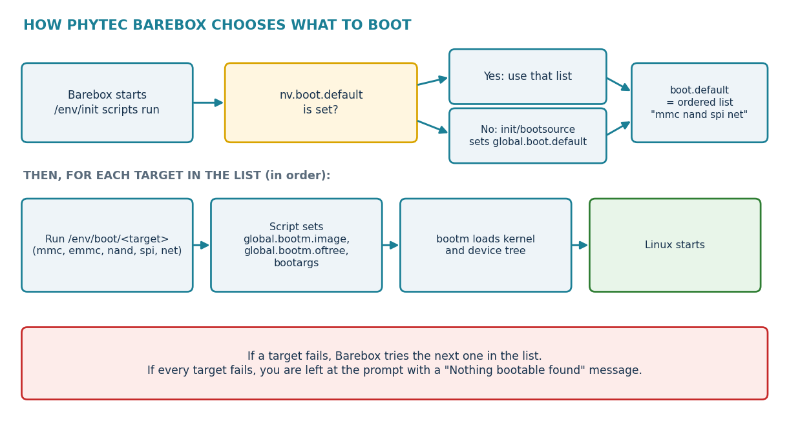
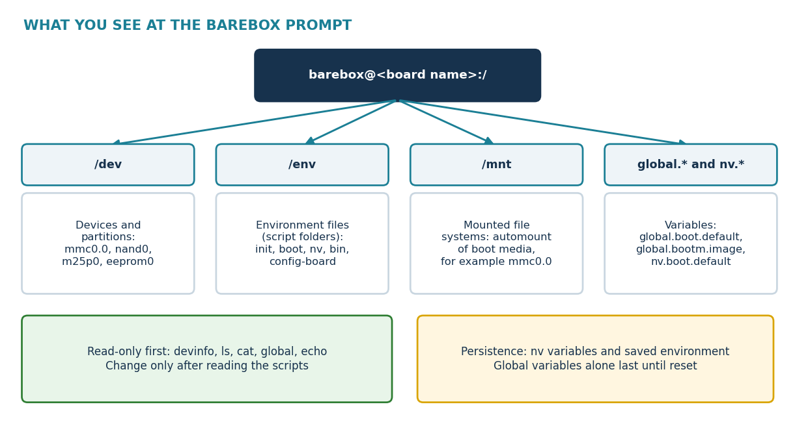

.. START:section:1:1
Barebox Runtime Configuration and Troubleshooting
=================================================

.. END:section:1:1

.. START:main_content:1:1
Read the environment of a PHYTEC board: init scripts, boot scripts and variables.

.. END:main_content:1:1

.. START:image:1:1:1

   bsp-08-barebox-boot-target-flow

.. END:image:1:1:1

|

.. START:section:1:2
Description: Objectives
=======================

.. END:section:1:2

.. START:main_content:1:2
Confirm that a board runs Barebox and not U-Boot.

Read the environment of a PHYTEC board: init scripts, boot scripts and variables.

Explain boot targets, boot.default and how the boot source changes the order.

Inspect devices, storage, memory, network and the device tree before Linux starts.

Boot a kernel by hand and change the kernel command line safely.

Tell temporary changes from persistent ones, and recover from a bad change.

.. END:main_content:1:2

.. START:image:1:2:2

   bsp-08-barebox-prompt-layout

.. END:image:1:2:2

|

.. START:section:1:3
Barebox on PHYTEC Boards
========================

.. END:section:1:3

.. START:main_content:1:3
Barebox is a bootloader with a small Unix-like shell. PHYTEC engineers maintain board support for several modules in the Barebox project, including the phyCORE-i.MX 6, phyCORE-i.MX 6UL and 6ULL, and phyCORE-AM335x. [1] [2] [3]

Table 1. Bootloader by PHYTEC platform

.. END:main_content:1:3

.. START:table:1:3:1

.. csv-table:: Table 1 - Documentation details
   :header: "Platform", "Bootloader", "Evidence"
   :align: center

   "phyCORE-i.MX 6, 6UL, 6ULL", "Barebox", "Board support and default environments by PHYTEC. Example version 2019.01.0-bsp-yocto-i.mx6ul-pd19.1.0. [2] [4]"
   "phyCORE-AM335x", "Barebox", "Default environment with boot scripts for mmc, emmc, nand, spi and net. [3]"
   "phyCORE-i.MX 8M Plus", "U-Boot", "BSP-06 and BSP-07"
   "phyCORE-AM62x, AM64x", "U-Boot", "BSP-06 and BSP-07"

.. END:table:1:3:1

.. START:table:1:3:2

.. csv-table::
.. warning::

   Identify the bootloader before you type a command Barebox and U-Boot commands are different. A Barebox prompt looks like barebox@<board name>:/, for example barebox@Phytec phyCORE-i.MX6 Quad with NAND:/. A U-Boot prompt is usually =>. If your board shows =>, use BSP-06 and BSP-07 instead. [5]

.. END:table:1:3:2

.. START:section:1:4
How the Barebox Prompt Is Organised
===================================

.. END:section:1:4

.. START:main_content:1:4
Barebox presents hardware and settings as files and variables. This helps once you know where to look.

Table 2. Main areas of the Barebox shell

.. END:main_content:1:4

.. START:table:1:4:1

.. csv-table:: Table 3 - Documentation details
   :header: "Area", "Meaning"
   :align: center

   "/dev", "Devices and partitions, for example mmc0.0, nand0 or a flash partition. Names depend on the board."
   "/env", "The environment as files. PHYTEC boards keep init, boot and nv folders and a config-board file here."
   "/mnt", "Mounted file systems. PHYTEC scripts mount each MMC boot source below /mnt, for example /mnt/mmc0.0. [6]"
   "global.* variables", "Run-time settings such as global.boot.default and global.bootm.image."
   "nv.* variables", "Non-volatile variables that survive a reset when saved. They override defaults."

.. END:table:1:4:1

.. START:table:1:4:2

.. csv-table::
.. tip::

   Use help as your reference Barebox builds differ. Use help to list the commands in your image and help <command> for the options of one command. Prefer that output to any older command list.

.. END:table:1:4:2

.. START:section:1:5
First Inspection: Read-Only Commands
====================================

.. END:section:1:5

.. START:main_content:1:5
Start every session with commands that cannot change anything. Capture the full serial log before you begin.

barebox@board:/ version

barebox@board:/ uname

barebox@board:/ devinfo

barebox@board:/ ls /dev

barebox@board:/ ls /env

barebox@board:/ ls /mnt

barebox@board:/ meminfo

barebox@board:/ echo $bootsource $bootsource_instance

barebox@board:/ global

Table 3. What the first commands tell you

.. END:main_content:1:5

.. START:table:1:5:1

.. csv-table:: Table 5 - Documentation details
   :header: "Command", "What it shows"
   :align: center

   "version, uname", "Barebox version and build identity."
   "devinfo", "Registered devices and their parameters. A missing storage device here is a bootloader problem, not a Linux problem."
   "ls /dev", "Device and partition names that boot scripts use."
   "ls /env, ls /mnt", "Environment files and the mounted boot media."
   "meminfo", "Memory map, useful when image load addresses overlap."
   "echo $bootsource", "The boot source the Boot ROM used, which changes the boot order (see below)."
   "global", "All global variables."

.. END:table:1:5:1

.. START:table:1:5:2

.. csv-table::
.. warning::

   Do not start by writing Avoid erase, raw flash writes and saveenv while you are still learning the layout. A wrong offset can remove the bootloader or the factory image.

.. END:table:1:5:2

.. START:section:1:6
The PHYTEC Environment
======================

.. END:section:1:6

.. START:main_content:1:6
PHYTEC ships a default environment with each Barebox board. The files below appear in the PHYTEC board directories in the Barebox source and are installed into /env. [3] [4] [6]

Table 4. Environment files on PHYTEC boards

barebox@board:/ cat /env/init/bootsource

barebox@board:/ cat /env/boot/mmc

barebox@board:/ cat /env/config-board

barebox@board:/ ls /env/nv

Read these files before you change any variable. They explain which device is read, which file names are used and which arguments Linux receives. Example values seen in PHYTEC defaults: linux.bootargs.base set to consoleblank=0 and linux.bootargs.rootfs set to rootwait ro fsck.repair=yes. [3]

.. END:main_content:1:6

.. START:table:1:6:1

.. csv-table:: Table 7 - Documentation details
   :header: "File or folder", "Purpose"
   :align: center

   "/env/init/bootsource", "Sets global.boot.default from the boot source. It stops at once if nv.boot.default is already set."
   "/env/init/automount", "Defines automount for the boot media, for example the MMC devices."
   "/env/boot/mmc, emmc, nand, spi, net", "One script per boot target. Each sets the kernel image, the device tree and the root file system."
   "/env/nv/ files", "Default values of non-volatile variables, for example boot.watchdog_timeout, linux.bootargs.base, linux.bootargs.rootfs and allow_color."
   "/env/config-board", "Board settings such as global.hostname and global.linux.bootargs.base."

.. END:table:1:6:1

.. START:table:1:6:2

.. csv-table::
.. note::

   Your board may differ These are examples from several Barebox versions and PHYTEC boards. A newer BSP can add files or rename variables. Trust what ls /env and cat show on your board.

.. END:table:1:6:2

.. START:section:1:7
Boot Targets and Boot Order
===========================

.. END:section:1:7

.. START:main_content:1:7
Barebox boots from a list of targets. The list is held in global.boot.default, and each name refers to a script in /env/boot/.

The boot-source script puts the source that the Boot ROM used first in the list. The examples below come from PHYTEC AM335x board scripts. [3]

Table 5. Boot order by boot source (phyCORE-AM335x example)

barebox@board:/ echo $global.boot.default

barebox@board:/ echo $nv.boot.default

barebox@board:/ boot -l # list boot entries, if supported by this build

barebox@board:/ boot mmc # boot one target for this session only

.. END:main_content:1:7

.. START:table:1:7:1

.. csv-table:: Table 9 - Documentation details
   :header: "Boot source", "Value of boot.default"
   :align: center

   "MMC", "mmc nand spi net (newer scripts insert emmc when an eMMC is present)"
   "NAND", "nand spi mmc net"
   "SPI", "spi nand mmc net"
   "Network", "net nand spi mmc"

.. END:table:1:7:1

.. START:table:1:7:2

.. csv-table::
.. important::

   A saved nv.boot.default wins If nv.boot.default is set, the boot-source script does nothing and your saved choice stays in force. This is how a saved boot target keeps working across resets.

.. END:table:1:7:2

.. START:section:1:8
Temporary and Persistent Changes
================================

.. END:section:1:8

.. START:main_content:1:8
Table 6. Global and non-volatile variables

# temporary test

barebox@board:/ global.boot.default="mmc net"

barebox@board:/ boot

# persistent choice, only after a successful test

barebox@board:/ nv boot.default=mmc

barebox@board:/ saveenv

# check which commands this build provides

barebox@board:/ help nv

barebox@board:/ help saveenv

The environment lives in a device that the board code selects. For example the NAND variant of the phyCORE-i.MX 6UL uses the /chosen/environment-nand path. A board with another storage uses another path. [4]

.. END:main_content:1:8

.. START:table:1:8:1

.. csv-table:: Table 11 - Documentation details
   :header: "Kind", "Example", "Lifetime"
   :align: center

   "Global variable", "global.boot.default=""mmc net""", "Until the next reset"
   "Non-volatile variable", "nv boot.default=mmc", "Until you change it. It is kept in the environment storage after the environment is saved."
   "Environment file", "A file under /env", "Whatever your board stores in the environment device"

.. END:table:1:8:1

.. START:table:1:8:2

.. csv-table::
.. warning::

   Record the original value first Write down every value before you change it. A saved boot target or boot argument can stop the board from booting on every power-up.

.. END:table:1:8:2

.. START:section:1:9
Boot a Kernel by Hand
=====================

.. END:section:1:9

.. START:main_content:1:9
A manual boot proves that the kernel, device tree and boot arguments are good, without touching the boot scripts. PHYTEC scripts set a few variables and then call bootm. You can set the same variables yourself. [4] [6]

Table 7. Variables used by a manual boot

barebox@board:/ ls /mnt/mmc

barebox@board:/ global.bootm.image=/mnt/mmc/zImage

barebox@board:/ global.bootm.oftree=/mnt/mmc/<board>.dtb

barebox@board:/ global.linux.bootargs.base="console=<tty>,115200"

barebox@board:/ bootm

Barebox can also read a boot entry file placed in /loader/entries/. Such a file names the kernel, the device tree and the options, and you can boot it with boot <device>, for example boot mmc3.0. [7]

.. END:main_content:1:9

.. START:table:1:9:1

.. csv-table:: Table 13 - Documentation details
   :header: "Variable", "Purpose"
   :align: center

   "global.bootm.image", "Path of the kernel image, for example /mnt/mmc/zImage."
   "global.bootm.oftree", "Path of the device tree that is handed to Linux."
   "global.linux.bootargs.base", "Basic arguments such as the console."
   "global.linux.bootargs.dyn.root", "Root file-system arguments set by the boot script, for example a root=/dev/mmcblk1p2 entry."
   "nv linux.bootargs.rootfs", "Persistent arguments added for the root file system."

.. END:table:1:9:1

.. START:table:1:9:2

.. csv-table::
.. tip::

   Keep the working boot Test with a variable change first, not with a script edit. If the manual boot works and the script boot does not, the difference is in the script or a saved variable.

.. END:table:1:9:2

.. START:section:1:10
Hardware Checks at the Prompt
=============================

.. END:section:1:10

.. START:main_content:1:10
Table 8. Common checks before Linux starts

barebox@board:/ of_dump /model

barebox@board:/ of_dump /chosen

barebox@board:/ help of_dump

barebox@board:/ ifup eth0

barebox@board:/ ping <server-ip>

barebox@board:/ cat /env/boot/net # how PHYTEC boots from the network

.. END:main_content:1:10

.. START:table:1:10:1

.. csv-table:: Table 15 - Documentation details
   :header: "Area", "Typical commands", "What you learn"
   :align: center

   "Storage", "devinfo, ls /dev, ls /mnt", "Is the medium detected and readable?"
   "File system", "ls /mnt/mmc, cat <file>", "Are the kernel and DTB files present?"
   "Memory", "meminfo, md <address>", "Memory map and contents"
   "Network", "ifup eth0, dhcp, ping <server-ip>", "Does the Ethernet work before Linux?"
   "I²C and GPIO", "i2c_probe, gpio_get_value", "Is a device or signal visible?"
   "Device tree", "of_dump", "What Barebox itself uses"

.. END:table:1:10:1

.. START:table:1:10:2

.. csv-table::
.. warning::

   Memory and flash writes are not experiments Commands such as mw, erase, cp to a flash device and saveenv change the board. Use them only with a known offset, a backup and a serial console, and never on the only copy of the working bootloader.

.. END:table:1:10:2

.. START:section:1:11
Watchdog and Redundant Boot
===========================

.. END:section:1:11

.. START:main_content:1:11
PHYTEC defaults include a boot watchdog value, and Barebox offers a bootchooser for redundant systems. [3] [8]

Table 9. Boot supervision features

.. END:main_content:1:11

.. START:table:1:11:1

.. csv-table:: Table 17 - Documentation details
   :header: "Item", "Meaning"
   :align: center

   "nv boot.watchdog_timeout", "Starts the watchdog before Linux. A default of 60 seconds is used in PHYTEC AM335x defaults. Linux must then keep it alive."
   "boot -w <seconds>", "Sets the watchdog for one boot."
   "boot.default = bootchooser", "Lets the bootchooser pick between systems such as system0 and system1."
   "bootchooser.targets, bootchooser.system0.boot", "Variables that list the systems and their boot targets."
   "state", "Shows the state instances that the bootchooser stores, for example in an EEPROM."

.. END:table:1:11:1

.. START:table:1:11:2

.. csv-table::
.. warning::

   A missing state node stops the bootchooser The message bootchooser: Cannot get state means that the state node is missing in the Barebox device tree of that release. [8] Do not solve it by editing variables; check the board device tree and the Barebox version.

.. END:table:1:11:2

.. START:section:1:12
Barebox and the Device Tree
===========================

.. END:section:1:12

.. START:main_content:1:12
Barebox uses a device tree for its own devices and hands a device tree to Linux. The device-tree files for PHYTEC boards live in the Barebox source, for example arch/arm/dts/imx6ul-phytec-phycore-som.dts for the phyCORE-i.MX 6UL. [4]

Table 10. Which document to use

.. END:main_content:1:12

.. START:table:1:12:1

.. csv-table:: Table 19 - Documentation details
   :header: "Problem", "Use"
   :align: center

   "Barebox cannot see a storage device", "This guide first, then the Barebox device tree"
   "Boot variable selects the wrong target", "This guide"
   "Linux has the wrong board model", "global.bootm.oftree and the live tree (BSP-03)"
   "Linux peripheral is disabled", "Linux device tree and pinmux (BSP-03 and BSP-04)"
   "The board uses U-Boot", "BSP-06 and BSP-07"

.. END:table:1:12:1

.. START:section:1:13
U-Boot Equivalents for NXP i.MX 8M and TI AM6x
==============================================

.. END:section:1:13

.. START:main_content:1:13
Newer PHYTEC boards use U-Boot. The task is the same, but the commands differ. Use this table to translate.

Table 11. Barebox and U-Boot commands for similar tasks

.. END:main_content:1:13

.. START:table:1:13:1

.. csv-table:: Table 20 - Documentation details
   :header: "Task", "Barebox", "U-Boot"
   :align: center

   "Show devices", "devinfo, ls /dev", "bdinfo, mmc list, mtd list"
   "List files", "ls /mnt/mmc", "ls mmc 1:1"
   "Show variables", "global, echo $name", "printenv"
   "Change a variable", "global.name=value", "setenv name value"
   "Save permanently", "nv name=value, saveenv", "saveenv"
   "Select Linux DTB", "global.bootm.oftree", "setenv fdtfile <name> (BSP-07)"
   "Optional hardware overlays", "Check help of_overlay", "setenv overlays <file>.dtbo (BSP-07)"
   "Boot", "boot, bootm", "boot, bootm"
   "Show a tree", "of_dump", "fdt addr, fdt print"
   "Reset the environment", "Restore as in your BSP manual", "env default -f -a"

.. END:table:1:13:1

.. START:table:1:13:2

.. csv-table::
.. warning::

   Do not copy commands across bootloaders An unknown command usually means the wrong bootloader or a feature that was not built. Check the prompt and help first.

.. END:table:1:13:2

.. START:section:1:14
Debug a Failed Boot
===================

.. END:section:1:14

.. START:main_content:1:14
Table 12. Last visible output and the first thing to check

Record the last serial message and the exact prompt.

Run version, devinfo and ls /dev.

Check that the boot medium and partition are visible and readable.

List the boot directory and confirm the kernel and device-tree files.

Read /env/boot/<target> and the boot variables without changing them.

Try a manual boot with the variables above.

Compare with a known-good image and serial log.

.. END:main_content:1:14

.. START:table:1:14:1

.. csv-table:: Table 22 - Documentation details
   :header: "Last output", "Investigate first"
   :align: center

   "No Barebox banner", "Power, boot switches, boot medium, serial settings or the early loader"
   "Barebox prompt after a timeout", "Boot scripts, boot.default, storage or missing image"
   "Nothing bootable found", "Boot target list, mount paths, file names, state node (bootchooser)"
   "Kernel starts and then stops", "Device tree, bootargs, console, root file system"
   "Linux login appears", "Barebox completed; continue with BSP-09"

.. END:table:1:14:1

.. START:section:1:15
Common Barebox Problems
=======================

.. END:section:1:15

.. START:main_content:1:15
Table 13. Symptoms and first checks

.. END:main_content:1:15

.. START:table:1:15:1

.. csv-table:: Table 23 - Documentation details
   :header: "Symptom", "Likely cause", "First check"
   :align: center

   "Command not found", "Feature not built or wrong bootloader", "help, prompt text"
   "Device missing in devinfo", "Driver, device tree, power or boot medium", "Barebox device tree, hardware"
   "ls /mnt/mmc is empty or fails", "Automount missing or wrong device", "/env/init/automount, ls /dev"
   "Boot script does nothing", "Wrong variable, missing file or failed step", "cat /env/boot/<target> and run steps by hand"
   "Linux has the wrong console", "Wrong bootargs", "global.linux.bootargs.base"
   "Boot order is not what you expect", "nv.boot.default is set", "echo $nv.boot.default"
   "Saved change prevents boot", "Persistent variable is wrong", "Boot from another medium and restore the saved values"

.. END:table:1:15:1

.. START:section:1:16
Safe Barebox Workflow
=====================

.. END:section:1:16

.. START:main_content:1:16
Confirm that the board uses Barebox.

Connect the serial console and save the whole boot log.

Run read-only commands and save the output.

Read the init and boot scripts.

Make a temporary change and test one thing at a time.

Use a manual boot to separate script faults from image faults.

Keep a known-good boot medium and a recovery path.

Save a persistent change only after a successful test.

Record the final values, files and log.

.. END:main_content:1:16

.. START:table:1:16:1

.. csv-table::
.. danger::

   Storage writes can remove the boot path Erasing or writing the wrong device from the bootloader prompt can overwrite the bootloader, the kernel or the factory image. Keep a serial console connected and use read-only inspection until the target device and offset are certain.

.. END:table:1:16:1

.. START:section:1:17
Barebox Checklist
=================

.. END:section:1:17

.. START:main_content:1:17
☐ Bootloader confirmed from the prompt and the banner.

☐ Full boot log saved.

☐ devinfo, /env and global output saved.

☐ Boot scripts and nv values read.

☐ Manual boot tested with the working files.

☐ Changes tested as global variables before nv and saveenv.

☐ Recovery medium ready.

☐ Final values and log recorded.

.. END:main_content:1:17

.. START:section:1:18
Glossary
========

.. END:section:1:18

.. START:main_content:1:18
Table 14. Terms used in this guide

.. END:main_content:1:18

.. START:table:1:18:1

.. csv-table:: Table 25 - Documentation details
   :header: "Term", "Meaning"
   :align: center

   "Barebox", "A bootloader with a shell and a file-based environment."
   "Global variable", "A Barebox variable that applies to the current session."
   "nv variable", "A non-volatile variable that is stored when the environment is saved."
   "Boot target", "A named boot script in /env/boot/, such as mmc or nand."
   "Bootsource", "The medium the processor Boot ROM used to start Barebox."
   "Bootchooser", "Barebox framework for redundant systems with attempt counters."
   "State", "Barebox storage for data such as boot attempts."
   "Automount", "Automatic mounting of boot media when a path under /mnt is used."

.. END:table:1:18:1

.. START:section:1:19
References
==========

.. END:section:1:19

.. START:main_content:1:19
Sources were checked on 30 October 2026. The manual of your own BSP release takes precedence.

[1] Barebox documentation. ``https://www.barebox.org/doc/latest/user/barebox.html <https://www.barebox.org/doc/latest/user/barebox.html>`_ <https://www.barebox.org/doc/latest/user/barebox.html>`_ Barebox user manual, shell and variables.

[2] Barebox mailing list: phyCORE-i.MX 6UL support. ``https://lore.barebox.org/barebox/1562071065-367410-6-git-send-email-s.riedmueller@phytec.de <https://lore.barebox.org/barebox/1562071065-367410-6-git-send-email-s.riedmueller@phytec.de>`_ <https://lore.barebox.org/barebox/1562071065-367410-6-git-send-email-s.riedmueller@phytec.de>`_ PHYTEC default environment for phyCORE-i.MX 6UL and 6ULL.

[3] Barebox mailing list: phytec-som-am335x boot scripts. ``https://lists.infradead.org/pipermail/barebox/2017-June/030527.html <https://lists.infradead.org/pipermail/barebox/2017-June/030527.html>`_ <https://lists.infradead.org/pipermail/barebox/2017-June/030527.html>`_ AM335x boot scripts, nv defaults and boot order.

[4] Barebox mailing list: phytec-phycore-imx6ul. ``https://lore.barebox.org/barebox/20170109105037.atfxmgb2vq2u74k6@pengutronix.de/t <https://lore.barebox.org/barebox/20170109105037.atfxmgb2vq2u74k6@pengutronix.de/t>`_ <https://lore.barebox.org/barebox/20170109105037.atfxmgb2vq2u74k6@pengutronix.de/t>`_ Board code, environment path and device tree names.

[5] Barebox mailing list: bootchooser and state on phyCORE-i.MX 6. ``https://lore.pengutronix.de/barebox/f451a45a-a4bc-f285-0614-001cb3a57405@pengutronix.de <https://lore.pengutronix.de/barebox/f451a45a-a4bc-f285-0614-001cb3a57405@pengutronix.de>`_ <https://lore.pengutronix.de/barebox/f451a45a-a4bc-f285-0614-001cb3a57405@pengutronix.de>`_ Prompt text and state error.

[6] Barebox mailing list: phytec-som-am335x automount. ``https://lore.barebox.org/barebox/20170511091446.evilkhroas4jmck5@pengutronix.de/t <https://lore.barebox.org/barebox/20170511091446.evilkhroas4jmck5@pengutronix.de/t>`_ <https://lore.barebox.org/barebox/20170511091446.evilkhroas4jmck5@pengutronix.de/t>`_ Automount of MMC boot sources.

[7] Barebox mailing list: bootloader spec entries. ``https://lists.infradead.org/pipermail/barebox/2016-April/026900.html <https://lists.infradead.org/pipermail/barebox/2016-April/026900.html>`_ <https://lists.infradead.org/pipermail/barebox/2016-April/026900.html>`_ Boot entries and boot mmc3.0.

[8] Barebox bootchooser. ``https://www.barebox.org/doc/latest/user/bootchooser.html <https://www.barebox.org/doc/latest/user/bootchooser.html>`_ <https://www.barebox.org/doc/latest/user/bootchooser.html>`_ Redundant boot framework.

[9] Barebox command reference. ``https://www.barebox.org/doc/latest/commands.html <https://www.barebox.org/doc/latest/commands.html>`_ <https://www.barebox.org/doc/latest/commands.html>`_ Command list.

[10] Barebox: booting Linux. ``https://www.barebox.org/doc/latest/user/booting-linux.html <https://www.barebox.org/doc/latest/user/booting-linux.html>`_ <https://www.barebox.org/doc/latest/user/booting-linux.html>`_ bootm and the boot framework.

.. END:main_content:1:19
