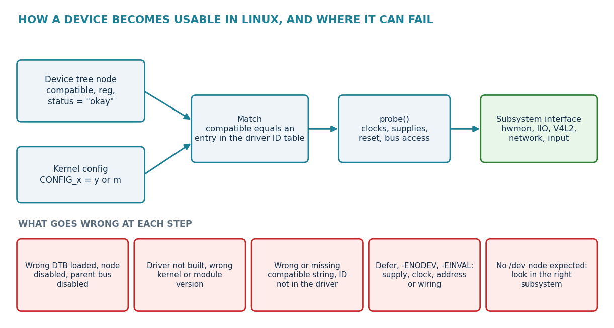
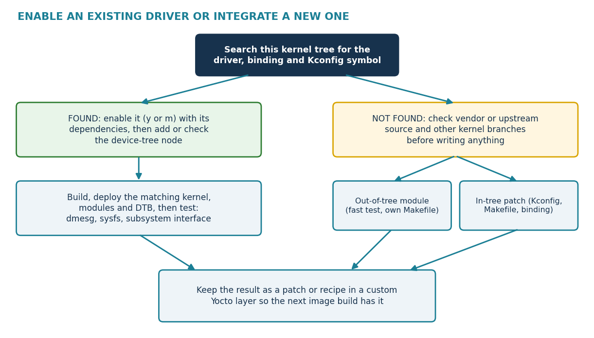

.. START:section:0:0
Objectives
==========

.. END:section:0:0

.. START:list:0:0:0

.. LIST_META: {"type": "bullet", "head": "", "items": ["Explain how Linux matches a device to a driver and what probe() does.", "Find an existing driver, its binding and its Kconfig symbol in a PHYTEC kernel tree.", "Enable a driver as built-in or as a module, in a standalone build and in a Yocto build.", "Write or check the device-tree node that makes the driver bind.", "Prove the result on the board with logs, sysfs and a functional test.", "Choose between an out-of-tree module and an in-tree patch when a driver is missing."]}

- Explain how Linux matches a device to a driver and what probe() does.
- Find an existing driver, its binding and its Kconfig symbol in a PHYTEC kernel tree.
- Enable a driver as built-in or as a module, in a standalone build and in a Yocto build.
- Write or check the device-tree node that makes the driver bind.
- Prove the result on the board with logs, sysfs and a functional test.
- Choose between an out-of-tree module and an in-tree patch when a driver is missing.

.. END:list:0:0:0

.. START:section:0:1
How Linux Matches a Driver to a Device
======================================

.. END:section:0:1

.. START:main_content:0:1
A driver is kernel code that controls one kind of hardware. It becomes useful only when several things agree: the device tree describes the device, the driver is built, the identities match, and probe() succeeds.

.. END:main_content:0:1

.. START:image:0:1:0

   Figure 1. How a device becomes usable in Linux

.. END:image:0:1:0

|

.. START:table:0:1:1

.. csv-table:: Table 1. Terms used in driver binding
   :header: "Term", "Meaning"
   :widths: 25, 75
   :align: center

   "compatible", "Device-tree string that names the hardware. The kernel compares it with the match table of each driver. [1] [2]"
   "ID table", "List of identities a driver supports, for example an of_device_id table for device-tree matching."
   "probe()", "Callback that Linux runs after a match. It requests resources and initialises the device. A match does not prove that probe succeeds."
   "Built-in (=y)", "Driver compiled into the kernel image. It does not appear in lsmod."
   "Module (=m)", "Driver built as a .ko file that is loaded when needed. It must match the running kernel."
   "Subsystem", "The Linux framework that the driver registers with, such as hwmon, IIO, V4L2, network or input."

.. END:table:0:1:1

.. START:tip:0:1:2

.. tip::

   | **Three questions for every missing device**
   | Is the driver built into this kernel? Does the booted device tree describe the device? Did probe() finish successfully? Answer them in this order with evidence.

.. END:tip:0:1:2

Check the Hardware First
------------------------

A correct driver cannot make an unpowered, unwired or wrongly addressed device work. Before any software change, collect these facts from the schematic, datasheet and PHYTEC manuals.

.. START:list:0:1:4

.. LIST_META: {"type": "bullet", "head": "", "items": ["Exact chip or module name and revision, and whether it sits on the SoM, the carrier board or an external add-on.", "Bus and address: I²C bus number and address, SPI chip select, UART port or USB port.", "Supply voltage, reset line, interrupt line, clock input and the pin configuration (BSP-04).", "Whether another component already uses the same bus address or pin."]}

- Exact chip or module name and revision, and whether it sits on the SoM, the carrier board or an external add-on.
- Bus and address: I²C bus number and address, SPI chip select, UART port or USB port.
- Supply voltage, reset line, interrupt line, clock input and the pin configuration (BSP-04).
- Whether another component already uses the same bus address or pin.

.. END:list:0:1:4

Find an Existing Driver
-----------------------

Search the kernel tree of your own BSP release, not the newest upstream kernel. A PHYTEC tree can contain drivers that mainline does not, and a mainline driver may be missing from an older tree.

.. START:table:0:1:6

.. csv-table:: Table 2. Ways to search for a driver
   :header: "Search for", "Where to look"
   :widths: 30, 70
   :align: center

   "Part number or name", "drivers/, Documentation/devicetree/bindings/, the datasheet"
   "compatible string", "Board .dts and .dtsi files and the of_device_id tables in drivers"
   "Configuration symbol", "Kconfig files, the Makefile of the same directory and the final .config"
   "Subsystem folder", "drivers/hwmon, drivers/iio, drivers/media, drivers/net, drivers/rtc, drivers/input and others"
   "Message in the log", "dmesg output and the driver source that prints it"

.. END:table:0:1:6

.. START:code:0:1:7

.. code-block:: console

   # run from the kernel source root
   $ grep -rn "ti,tmp102" drivers/ Documentation/devicetree/bindings/
   $ grep -rn "config SENSORS_TMP102" drivers/hwmon/Kconfig
   $ grep -n "tmp102" drivers/hwmon/Makefile
    
   # a PHYTEC camera driver: find the file, then its symbol
   $ find drivers/media/i2c -name "ar0144*"
   $ grep -n "ar0144" drivers/media/i2c/Makefile drivers/media/i2c/Kconfig

.. END:code:0:1:7

The Makefile line names the object file and the Kconfig symbol that controls it, for example obj-$(CONFIG_SYMBOL) += file.o. Read both lines to learn the symbol.

.. START:table:0:1:9

.. csv-table:: Table 3. Example drivers found in the supplied trees (source files only)
   :header: "Driver file", "Device", "i.MX 8M Plus", "i.MX 6UL", "AM335x", "AM62x / AM64x"
   :widths: 25, 25, 12, 12, 12, 14
   :align: center

   "drivers/hwmon/tmp102.c", "TI TMP102 temperature sensor", "Yes", "Yes", "Yes", "Yes / Yes"
   "drivers/rtc/rtc-rv3028.c", "RV-3028 real-time clock", "Yes", "Yes", "Yes", "Yes / Yes"
   "drivers/net/phy/dp83867.c", "TI DP83867 Ethernet PHY", "Yes", "Yes", "Yes", "Yes / Yes"
   "drivers/media/i2c/ar0521.c", "onsemi AR0521 camera sensor", "Yes", "Yes", "Yes", "Yes / Yes"
   "drivers/media/i2c/ar0144.c", "onsemi AR0144 camera sensor (phyCAM-M VM-016)", "Yes", "No", "No", "Yes / No"

.. END:table:0:1:9

.. START:warning:0:1:10

.. warning::

   | **A source file in the tree is not an enabled driver**
   | The table shows only that the source file exists. A driver works only if its symbol is y or m in the configuration that built your kernel, and a node in the booted device tree matches it. Other trees can differ, so repeat the search in yours.

.. END:warning:0:1:10

Kernel Configuration for a Driver
---------------------------------

.. START:table:0:1:12

.. csv-table:: Table 4. Driver configuration states
   :header: "Setting", "Meaning", "Result"
   :widths: 30, 25, 45
   :align: center

   "CONFIG_EXAMPLE=y", "Built into the kernel image", "Available from kernel start. No .ko file."
   "CONFIG_EXAMPLE=m", "Built as a module", "A .ko file is created. The target needs the matching file and its dependencies."
   "# CONFIG_EXAMPLE is not set", "Disabled", "The driver is not built."

.. END:table:0:1:12

.. START:list:0:1:13

.. LIST_META: {"type": "bullet", "head": "", "items": ["Choose y when the device is needed early, for example a root filesystem device or a boot-time console. Choose m for optional hardware that you want to load and update separately.", "A symbol can depend on other symbols, for example depends on I2C. If a dependency is not enabled, the option stays hidden in menuconfig.", "Read the help text and depends on lines of the Kconfig entry before you enable the driver."]}

- Choose y when the device is needed early, for example a root filesystem device or a boot-time console. Choose m for optional hardware that you want to load and update separately.
- A symbol can depend on other symbols, for example depends on I2C. If a dependency is not enabled, the option stays hidden in menuconfig.
- Read the help text and depends on lines of the Kconfig entry before you enable the driver.

.. END:list:0:1:13

.. START:code:0:1:14

.. code-block:: console

   $ grep -n "^CONFIG_SENSORS_TMP102" .config
   $ grep -n "^# CONFIG_SENSORS_TMP102" .config
   # on a running board, when the kernel exports its configuration
   $ zcat /proc/config.gz | grep CONFIG_SENSORS_TMP102

.. END:code:0:1:14

Enable a Driver in a Standalone Build
-------------------------------------

Use the standalone workflow of BSP-02 with the SDK and defconfig of your release. The steps below show the order only.

.. START:list:0:1:16

.. LIST_META: {"type": "auto", "head": "", "items": ["Source the SDK environment of your BSP release in the terminal.", "Load the board defconfig named in your BSP manual, for example make phytec_ti_defconfig on TI AM6x.", "Open the menu with make menuconfig, search with / for the symbol and enable it with y or m. Enable the bus or subsystem it depends on.", "Save and compare. Run make savedefconfig and compare the result with the original to see exactly what changed.", "Build the kernel, modules and device trees as in BSP-02.", "Deploy the matching kernel, modules and DTB, boot, and verify (see the verification section)."]}

1. Source the SDK environment of your BSP release in the terminal.
2. Load the board defconfig named in your BSP manual, for example make phytec_ti_defconfig on TI AM6x.
3. Open the menu with make menuconfig, search with / for the symbol and enable it with y or m. Enable the bus or subsystem it depends on.
4. Save and compare. Run make savedefconfig and compare the result with the original to see exactly what changed.
5. Build the kernel, modules and device trees as in BSP-02.
6. Deploy the matching kernel, modules and DTB, boot, and verify (see the verification section).

.. END:list:0:1:16

.. START:warning:0:1:17

.. warning::

   **Modules must match the kernel** A module built for another kernel version, configuration or architecture fails to load. Install the modules that were built together with the kernel you boot, with the same uname -r string.

.. END:warning:0:1:17

Enable a Driver in a Yocto Build
--------------------------------

PHYTEC documents bitbake -c menuconfig virtual/kernel for opening the kernel configuration in a Yocto build. The provider and recipe name can differ by BSP release.

.. START:code:0:1:19

.. code-block:: console

   $ bitbake -c menuconfig virtual/kernel
   $ bitbake -c diffconfig virtual/kernel    # writes a fragment with your changes
   $ bitbake -c compile -f virtual/kernel
   $ bitbake <image-name>

.. END:code:0:1:19

.. START:table:0:1:20

.. csv-table:: Table 5. Where a driver change is kept in Yocto
   :header: "Change", "Possible artifact", "Note"
   :widths: 25, 35, 40
   :align: center

   "Enable an existing driver", "Kernel configuration fragment, for example a file that sets CONFIG_SENSORS_TMP102=m", "Add it from your own layer to the kernel recipe, if the recipe of your release supports fragments."
   "Add or fix driver source", "Kernel patch with Kconfig and Makefile changes", "Created with git format-patch from your standalone tree (BSP-02)."
   "Add a device-tree node", "DTS or DTSI patch, or an overlay", "Remember that the booted DTB or FIT image must contain it (BSP-03)."
   "Out-of-tree module", "Module recipe that builds against the kernel", "Must be rebuilt when the kernel changes."
   "Firmware for the device", "Firmware recipe and image package", "Check the firmware name in dmesg."

.. END:table:0:1:20

.. START:important:0:1:21

.. important::

   | **Interactive edits are not reproducible**
   | A change made only in menuconfig inside a temporary build directory can be lost in the next clean build. Keep every driver change as a patch or fragment in a custom layer. The layer and recipe details are in the Yocto section.

.. END:important:0:1:21

Bind the Driver with the Device Tree
------------------------------------

The device tree tells Linux that the hardware exists and gives its resources. The driver match table says which hardware the driver supports. Both must agree.

.. START:table:0:1:23

.. csv-table:: Table 6. Common device-tree properties for drivers
   :header: "Property", "What it tells Linux"
   :widths: 30, 70
   :align: center

   "compatible", "Which hardware and which driver binding should match."
   "reg", "Bus address or register range. For an I²C device it is the address, for example 0x10."
   "status", "okay enables the node. A disabled node or a disabled parent bus is never probed."
   "interrupts", "Interrupt connection, when the device uses one."
   "clocks, clock-names", "Clock inputs required by the device."
   "resets, reset-gpios", "How the device is reset."
   "*-supply", "Regulator that powers the device."
   "pinctrl-names, pinctrl-0", "Pin configuration states (BSP-04)."
   "firmware-name", "Firmware file requested by some devices."

.. END:table:0:1:23

.. START:list:0:1:24

.. LIST_META: {"type": "bullet", "head": "Where the Node Goes", "items": ["A device on a bus is a child of that bus node. An I²C sensor is written inside the node of its I²C controller, and the controller must be enabled.", "A memory-mapped SoC block is enabled with status = \"okay\" in the board file, because the SoC file keeps it disabled.", "Optional hardware belongs in an overlay, so that one image supports several hardware options (BSP-03).", "Put the node in the file that owns the hardware: carrier devices in the carrier or board file, SoM devices in the SoM file."]}

.. container:: spx-list-head

    **Where the Node Goes**

- A device on a bus is a child of that bus node. An I²C sensor is written inside the node of its I²C controller, and the controller must be enabled.
- A memory-mapped SoC block is enabled with status = "okay" in the board file, because the SoC file keeps it disabled.
- Optional hardware belongs in an overlay, so that one image supports several hardware options (BSP-03).
- Put the node in the file that owns the hardware: carrier devices in the carrier or board file, SoM devices in the SoM file.

.. END:list:0:1:24

| **Read the Binding Before You Edit**
| The binding defines which properties exist and which are required. Modern bindings are YAML files below Documentation/devicetree/bindings/. Copy properties from the binding and from a working node of the same kernel version, not from an old web example.

.. START:code:0:1:26

.. code-block:: console

   $ grep -rn "compatible" Documentation/devicetree/bindings/ | grep -i "tmp102"
   # validate when the dt-schema tools are installed
   $ make dt_binding_check DT_SCHEMA_FILES=<binding-file>.yaml
   $ make dtbs_check

.. END:code:0:1:26

.. START:warning:0:1:27

.. warning::

   | **Do not force a match**
   | Never add an arbitrary compatible string to make a driver bind. The driver must really support the chip and its programming interface.

.. END:warning:0:1:27

Example: PHYTEC phyCAM-M VM-016 Camera
--------------------------------------

This example is taken from PHYTEC documentation and uses an existing driver. The VM-016 phyCAM-M module contains an onsemi AR0144 image sensor. On the AM62x phyBOARD-Lyra kit it is connected to the camera connector X28.

.. START:table:0:1:29

.. csv-table:: Table 7. Evidence chain of the VM-016 camera on AM62x
   :header: "Step", "Evidence"
   :widths: 25, 75
   :align: center

   "Hardware", "The camera module is connected to connector X28 of the carrier board. [6]"
   "Driver source", "drivers/media/i2c/ar0144.c exists in the supplied AM62x and i.MX 8M Plus trees."
   "Device-tree overlay", "k3-am62-phyboard-lyra-vm016-mipi.dtso (compiled to .dtbo) is present in the supplied AM62x tree."
   "Node properties", "An i.MX 8M Mini overlay for the same sensor uses compatible = ""onsemi,ar0144"" and reg = <0x10>. [7]"
   "Enabling the overlay", "In U-Boot: setenv overlays k3-am62-phyboard-lyra-vm016-mipi.dtbo, then boot. [6]"
   "Bound device", "The media pipeline names the device ar0144 1-0010: I²C bus 1, address 0x10. [6]"
   "Functional test", "media-ctl sets the format and a GStreamer pipeline captures a picture from /dev/video0. [6]"

.. END:table:0:1:29

The sysfs name of an I²C client is the bus number and the address in four hexadecimal digits. The name 1-0010 therefore gives these checks on the board:

.. START:note:0:1:32

.. note::

   | **No /dev node for the sensor itself**
   | The driver registers with the media and V4L2 subsystems. The usable interfaces are /dev/media0 and /dev/video0, not a device file named after the sensor.

.. END:note:0:1:32

.. START:code:0:1:31

.. code-block:: console

   $ ls -l /sys/bus/i2c/devices/1-0010
   $ readlink /sys/bus/i2c/devices/1-0010/driver
   $ dmesg | grep -i ar0144
   $ ls /dev/video* /dev/media*

.. END:code:0:1:31

.. START:tip:0:1:33

.. tip::

   **Same method, other boards** The i.MX 8M Plus tree also holds the AR0144 driver and VM-016 overlays. Use the same chain: find the overlay, read its node, find the driver, check the log, then run the capture test. Names and bus numbers differ per board.

.. END:tip:0:1:33

Example: A Simple I²C Temperature Sensor
----------------------------------------

The next example is a learning example, not a statement that every PHYTEC board contains this sensor. The TI TMP102 driver exists in all five supplied trees and registers with the hwmon subsystem. Take the bus, address and supply from your own hardware.

.. START:code:0:1:35

.. code-block:: bash

   &i2c3 {
   	status = "okay";
    
   	temperature-sensor@48 {
   		compatible = "ti,tmp102";
   		reg = <0x48>;
   	};
   };

.. END:code:0:1:35

.. START:table:0:1:36

.. csv-table:: Table 8. Checks for the temperature-sensor example
   :header: "Check", "Question"
   :widths: 25, 75
   :align: center

   "Hardware", "Is the sensor really on this I²C bus at address 0x48, and is it powered?"
   "Controller", "Does the label &i2c3 exist in your device tree, is it enabled, and are its pins configured (BSP-04)?"
   "Binding", "Does the binding of your kernel list ti,tmp102 and any required supply property?"
   "Driver", "Is CONFIG_SENSORS_TMP102 set to y or m in your build?"
   "Runtime", "Does dmesg show a probe, and does hwmon show a temperature file?"

.. END:table:0:1:36

.. START:code:0:1:37

.. code-block:: console

   $ dmesg | grep -i tmp102
   $ readlink /sys/bus/i2c/devices/3-0048/driver
   $ cat /sys/class/hwmon/hwmon*/name
   $ cat /sys/class/hwmon/hwmon*/temp1_input    # millidegrees Celsius

.. END:code:0:1:37

Verify Binding and Probe on the Board
-------------------------------------

Start by confirming the running device tree (BSP-03). Then follow the evidence from the log to the subsystem.

.. START:code:0:1:39

.. code-block:: console

   $ uname -r
   $ dmesg -T | grep -iE "probe|firmware|error|fail|<device-name>"
   $ ls -l /sys/bus/i2c/devices/ /sys/bus/spi/devices/ /sys/bus/platform/devices/
   $ readlink /sys/bus/i2c/devices/<bus-addr>/driver
   $ cat /sys/kernel/debug/devices_deferred     # needs debugfs
   $ lsmod | grep -i <module>
   $ modinfo <module>

.. END:code:0:1:39

.. START:table:0:1:40

.. csv-table:: Table 9. Evidence to collect
   :header: "Evidence", "What it proves"
   :widths: 35, 65
   :align: center

   "Live model and compatible", "The intended device description is running."
   ".config or /proc/config.gz", "The driver was built with the expected setting."
   "dmesg", "The driver matched and either succeeded or reported a failure."
   "sysfs driver link", "The device is bound to a driver."
   "Subsystem node", "Linux exposed the device through its standard interface."
   "Functional test", "The hardware works, not only the driver."

.. END:table:0:1:40

**Probe Errors and Their Usual Meaning**

.. START:table:0:1:42

.. csv-table:: Table 10. Common probe results
   :header: "Result", "Usual meaning", "First action"
   :widths: 25, 38, 37
   :align: center

   "-EPROBE_DEFER (probe deferred)", "A supplier such as a regulator, clock or GPIO is not ready yet.", "Read the related dmesg lines and devices_deferred, then check the supplier node."
   "-ENODEV", "Wrong ID or compatible, or the chip did not answer as expected.", "Check the binding, the address, the power and the chip identity."
   "-EINVAL", "A property is missing, wrong or unsupported.", "Compare the node with the binding."
   "-ENOENT or firmware message", "A resource or firmware file is missing.", "Check the firmware name and the image contents."
   "-EREMOTEIO (-121) or -ENXIO (-6)", "No acknowledge from the bus address.", "Check wiring, address, pull-ups and power with a scope or analyser."
   "No message at all", "Driver not built, node not matched or wrong DTB.", "Check .config, status, compatible and the booted DTB."

.. END:table:0:1:42

**Bind and Unbind by Hand**

.. START:code:0:1:44

.. code-block:: console

   $ echo <bus-addr> > /sys/bus/i2c/drivers/<driver-name>/unbind
   $ echo <bus-addr> > /sys/bus/i2c/drivers/<driver-name>/bind
   # more detailed driver messages, when dynamic debug is enabled in the kernel
   $ echo "file <driver-file>.c +p" > /sys/kernel/debug/dynamic_debug/control

.. END:code:0:1:44

.. START:warning:0:1:45

.. warning::

   | **Use manual unbind only for diagnosis**
   | Unbinding a driver that controls a root filesystem, a console or a running service can stop the board. Use these commands on a development board and never in production.

.. END:warning:0:1:45

When No Driver Exists
---------------------

A new driver is a larger task than enabling an existing one. Confirm first that no driver exists under another name, in a newer kernel or from the chip vendor.

.. START:image:0:1:47

   Decision between enabling an existing driver and integrating a new one.

.. END:image:0:1:47

|

.. START:table:0:1:48

.. csv-table:: Table 11. Out-of-tree module compared with an in-tree patch
   :header: "Aspect", "Out-of-tree module", "In-tree patch"
   :widths: 20, 40, 40
   :align: center

   "Source location", "Own folder with its own Makefile", "Inside the kernel tree, next to similar drivers"
   "Best for", "Fast first test, vendor code, short experiments", "Product code that must be maintained and rebuilt with the kernel"
   "Needs", "A kernel tree already built with the same configuration", "Kconfig entry, Makefile line, binding and device-tree node"
   "Risk", "Breaks on every kernel change", "Larger patch and more review work"

.. END:table:0:1:48

.. START:list:0:1:49

.. LIST_META: {"type": "bullet", "head": "Main Integration Steps", "items": ["Read the datasheet: bus protocol, reset and power sequence, interrupts and registers.", "Choose the Linux subsystem (I²C, SPI, hwmon, IIO, input, V4L2, network and so on).", "Write the driver with a match table, probe() and clean error handling, following a nearby driver of the same subsystem.", "Add the Kconfig entry and the Makefile line so that the driver can be selected and built.", "Write or update the device-tree binding.", "Add the node to the board device tree or an overlay.", "Build, boot, read the log and run a functional test.", "Save everything as patches and integrate them into the Yocto build."]}

.. container:: spx-list-head

    **Main Integration Steps**

- Read the datasheet: bus protocol, reset and power sequence, interrupts and registers.
- Choose the Linux subsystem (I²C, SPI, hwmon, IIO, input, V4L2, network and so on).
- Write the driver with a match table, probe() and clean error handling, following a nearby driver of the same subsystem.
- Add the Kconfig entry and the Makefile line so that the driver can be selected and built.
- Write or update the device-tree binding.
- Add the node to the board device tree or an overlay.
- Build, boot, read the log and run a functional test.
- Save everything as patches and integrate them into the Yocto build.

.. END:list:0:1:49

**Kconfig and Makefile Entries**

.. START:code:0:1:51

.. code-block:: bash

   config SENSORS_EXAMPLE
   	tristate "Example sensor support"
   	depends on I2C
   	help
   	  Enable support for the example sensor.
    
   # in the Makefile of the same directory
   obj-$(CONFIG_SENSORS_EXAMPLE) += example.o

.. END:code:0:1:51

| **A Minimal Platform Driver to Learn the Pattern**
| This learning skeleton binds to a device-tree node and prints one message. It has no hardware access. Replace the compatible string with a documented one before any real use.

.. START:code:0:1:53

.. code-block:: console

   // SPDX-License-Identifier: GPL-2.0
   #include <linux/module.h>
   #include <linux/mod_devicetable.h>
   #include <linux/platform_device.h>
    
   static int phytec_demo_probe(struct platform_device *pdev)
   {
   	dev_info(&pdev->dev, "phytec-demo probed\n");
   	return 0;
   }
    
   static const struct of_device_id phytec_demo_of_match[] = {
   	{ .compatible = "phytec,demo-device" },
   	{ }
   };
   MODULE_DEVICE_TABLE(of, phytec_demo_of_match);
    
   static struct platform_driver phytec_demo_driver = {
   	.probe = phytec_demo_probe,
   	.driver = {
   		.name = "phytec-demo",
   		.of_match_table = phytec_demo_of_match,
   	},
   };
   module_platform_driver(phytec_demo_driver);
    
   MODULE_DESCRIPTION("Demo driver for learning");
   MODULE_LICENSE("GPL");

.. END:code:0:1:53

A top-level device-tree node with the same string makes Linux create a platform device that this driver can bind to:

.. START:code:0:1:55

.. code-block:: bash

   / {
   	phytec-demo {
   		compatible = "phytec,demo-device";
   		status = "okay";
   	};
   };

.. END:code:0:1:55

**Build It as an Out-of-Tree Module**

.. START:code:0:1:57

.. code-block:: bash

   # Makefile next to phytec-demo.c (indent lines with a tab)
   obj-m += phytec-demo.o
   KDIR ?= $(HOME)/linux-phytec-ti
    
   all:
   	$(MAKE) -C $(KDIR) M=$(PWD) modules
    
   clean:
   	$(MAKE) -C $(KDIR) M=$(PWD) clean
   # on the host, with the SDK environment sourced (BSP-02)
   make KDIR=<path-to-your-built-kernel-tree>

.. END:code:0:1:57

.. START:code:0:1:58

.. code-block:: console

   # on the board
   $ insmod ./phytec-demo.ko
   $dmesg | tail
   $ modinfo ./phytec-demo.ko | grep vermagic

.. END:code:0:1:58

The kernel tree in KDIR must be configured and built with the same configuration as the kernel on the board. The vermagic line must match uname -r.

.. START:warning:0:1:60

.. warning::

   | **Licence and review**
   | A kernel module that uses kernel interfaces is normally GPL. Check the licence of any vendor source code before you add it to a product, and keep one logical change per patch so that it can be reviewed.

.. END:warning:0:1:60

.. START:section:0:2
NXP and TI Differences
======================

.. END:section:0:2

.. START:main_content:0:2
The driver model is the same on both. The controller drivers, device-tree files and BSP kernel configuration differ.

.. END:main_content:0:2

.. START:table:0:2:0

.. csv-table:: Table 12. Typical controller drivers in the supplied trees
   :header: "Function", "NXP i.MX 8M Plus", "TI AM62x"
   :widths: 25, 37, 38
   :align: center

   "I²C controller", "drivers/i2c/busses/i2c-imx.c", "drivers/i2c/busses/i2c-omap.c"
   "UART", "drivers/tty/serial/imx.c", "drivers/tty/serial/8250/8250_omap.c"
   "CAN", "drivers/net/can/flexcan/flexcan-core.c", "drivers/net/can/m_can/m_can_platform.c"
   "SD / eMMC host", "drivers/mmc/host/sdhci-esdhc-imx.c", "drivers/mmc/host/sdhci_am654.c"
   "Board device trees", "arch/arm64/boot/dts/freescale/", "arch/arm64/boot/dts/ti/"
   "Pin configuration", "fsl,pins (BSP-04)", "pinctrl-single,pins (BSP-04)"

.. END:table:0:2:0

Confirm the controller for your SoC in its .dtsi: the compatible string of the controller node names the driver family. Do not assume that a property is identical across SoC families.

.. START:section:0:3
Common Driver Failures
======================

.. END:section:0:3

.. START:main_content:0:3
.. csv-table:: Table 13. Symptoms and first checks
   :header: "Symptom", "Likely cause", "First check"
   :widths: 30, 35, 35
   :align: center

   "No driver log at all", "Driver not built, node disabled or wrong DTB", ".config, status, compatible, live model"
   "Driver not in lsmod", "Built in, disabled or missing", "Configuration and /lib/modules"
   "Device exists but has no driver link", "Compatible or ID mismatch, or the driver is not loaded", "Binding, modinfo, modprobe"
   "Unknown symbol or module error", "Dependency missing or kernel and module mismatch", "dmesg, modinfo, uname -r"
   "Probe deferred forever", "A supplier never becomes ready", "devices_deferred and the supplier node"
   "Probe error on the bus", "Wrong address, no power, missing pull-up", "Scope or analyser, schematic"
   "Driver bound but no interface", "Expected node belongs to another subsystem", "Look in hwmon, IIO, V4L2, input or network"
   "Works on one board only", "Different wiring, device tree or pinmux", "Compare schematic, DTB and pin groups"

.. END:main_content:0:3

.. START:section:0:4
Safe Driver Workflow
====================

.. END:section:0:4

.. START:list:0:4:0

.. LIST_META: {"type": "bullet", "head": "", "items": ["Confirm the physical device, its bus and its power.", "Search the kernel tree for the driver, binding and Kconfig symbol.", "Enable the symbol with its dependencies in the matching configuration.", "Check or add the device-tree node with the properties of the binding.", "Build the kernel, modules and DTB, and deploy matching files.", "Boot and read dmesg, then check the sysfs bus and the subsystem interface.", "Run a real functional test.", "Write a new driver only if no suitable one exists.", "Keep the change as a patch or fragment in a custom Yocto layer."]}

- Confirm the physical device, its bus and its power.
- Search the kernel tree for the driver, binding and Kconfig symbol.
- Enable the symbol with its dependencies in the matching configuration.
- Check or add the device-tree node with the properties of the binding.
- Build the kernel, modules and DTB, and deploy matching files.
- Boot and read dmesg, then check the sysfs bus and the subsystem interface.
- Run a real functional test.
- Write a new driver only if no suitable one exists.
- Keep the change as a patch or fragment in a custom Yocto layer.

.. END:list:0:4:0

.. START:important:0:4:1

.. important::

   | **A successful build is not a working device**
   | The proof is a successful probe followed by a functional test on the real PHYTEC hardware.

.. END:important:0:4:1

.. START:section:0:5
Driver Enablement Checklist
===========================

.. END:section:0:5

.. START:list:0:5:0

.. LIST_META: {"type": "bullet", "head": "", "items": ["Hardware model, bus, address, power and pins confirmed.", "Kernel tree and BSP release match the target image.", "Driver source, binding and Kconfig symbol found.", "Symbol and its dependencies enabled as y or m.", "Device-tree node matches the binding and is enabled.", "Correct kernel, modules and DTB deployed.", "Log, driver link and subsystem interface checked.", "Functional test passed.", "Change saved as a patch or fragment in the Yocto layer."]}

- Hardware model, bus, address, power and pins confirmed.
- Kernel tree and BSP release match the target image.
- Driver source, binding and Kconfig symbol found.
- Symbol and its dependencies enabled as y or m.
- Device-tree node matches the binding and is enabled.
- Correct kernel, modules and DTB deployed.
- Log, driver link and subsystem interface checked.
- Functional test passed.
- Change saved as a patch or fragment in the Yocto layer.

.. END:list:0:5:0

.. START:section:0:6
Glossary and References
=======================

.. END:section:0:6

Glossary
--------

.. START:table:0:6:0

.. csv-table:: Table 14. Terms used in this guide
   :header: "Term", "Meaning"
   :widths: 30, 70
   :align: center

   "Driver binding", "Connecting a device to a driver after a successful match."
   "Deferred probe", "Retrying a probe later because a needed supplier was not ready."
   "Binding document", "The description of the device-tree properties of one device type."
   "Kconfig", "The language and files that define kernel options and dependencies."
   "Overlay", "A small device tree applied on top of a base tree."
   "Out-of-tree module", "A kernel module built outside the kernel source tree."
   "hwmon, IIO, V4L2", "Kernel subsystems for sensors, converters and cameras."
   "vermagic", "Version string inside a module that must match the running kernel."

.. END:table:0:6:0

References
----------

| Linux kernel documentation: `Driver Binding <https://docs.kernel.org/driver-api/driver-model/binding.html>`_
| Linux kernel documentation: `Platform Devices and Drivers <https://docs.kernel.org/driver-api/driver-model/platform.html>`_
| Linux kernel documentation: `Kconfig Language <https://docs.kernel.org/kbuild/kconfig-language.html>`_
| PHYTEC BSP documentation: `Yocto Manual (Scarthgap) <https://phytec.github.io/doc-bsp-yocto/yocto/scarthgap.html>`_
| Linux kernel documentation: `Writing Devicetree Bindings <https://docs.kernel.org/devicetree/bindings/writing-bindings.html>`_
| PHYTEC: `phyCORE-AM62x Camera Guide <https://docs.phytec.com/projects/yocto-phycore-am62x/en/latest/interfaceguides/camera.html>`_
| NXP Community: `AR0144 on an i.MX8MM PHYTEC Board <https://community.nxp.com/t5/Multi-Source-Translation-Content/2148184-en-US/ta-p/2235211>`_
| Linux kernel documentation: `Building External Modules <https://docs.kernel.org/kbuild/modules.html>`_
| Linux kernel source: `TMP102 Driver <https://github.com/torvalds/linux/blob/master/drivers/hwmon/tmp102.c>`_
