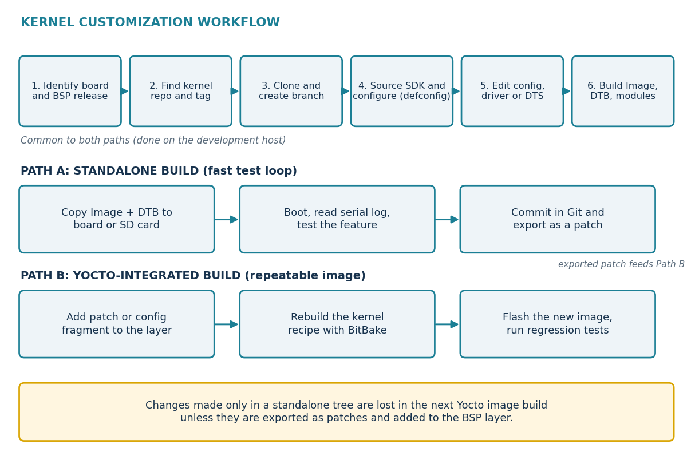
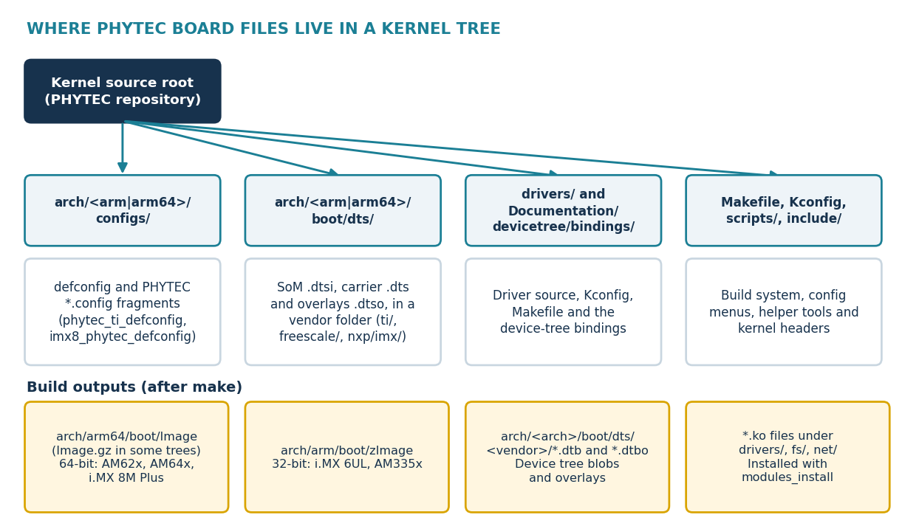

.. START:section:0:0
Objectives
==========

.. END:section:0:0

.. START:list:0:0:0

.. LIST_META: {"type": "bullet", "head": "", "items": ["Name the PHYTEC kernel repository and tag that belong to your BSP release.", "Read a PHYTEC kernel tag and tell the Linux version, the vendor base and the PHYTEC revision.", "Set up the PHYTEC SDK, clone the kernel and start a working branch.", "Find the PHYTEC defconfigs, device trees and build outputs inside the kernel tree.", "Configure and build the kernel, device trees and modules for a PHYTEC board.", "Keep changes as Git commits and patches so that they can reach a Yocto image build.", "Decide whether a problem can be fixed in the kernel or belongs somewhere else."]}

- Name the PHYTEC kernel repository and tag that belong to your BSP release.
- Read a PHYTEC kernel tag and tell the Linux version, the vendor base and the PHYTEC revision.
- Set up the PHYTEC SDK, clone the kernel and start a working branch.
- Find the PHYTEC defconfigs, device trees and build outputs inside the kernel tree.
- Configure and build the kernel, device trees and modules for a PHYTEC board.
- Keep changes as Git commits and patches so that they can reach a Yocto image build.
- Decide whether a problem can be fixed in the kernel or belongs somewhere else.

.. END:list:0:0:0

.. START:section:0:1
Kernel Role in BSP
==================

.. END:section:0:1

.. START:main_content:0:1
| The Linux kernel manages the processor, memory, interrupts, hardware drivers, networking and filesystems. Applications use kernel services and do not control most hardware directly. In a PHYTEC BSP the kernel is delivered together with a device tree that describes the board, a bootloader that loads both, and a root filesystem that holds the programs.
| PHYTEC maintains its own kernel repositories. They contain a Linux kernel, the silicon vendor patches (NXP or Texas Instruments) and the PHYTEC changes for its SoMs and carrier boards. The BSP release fixes one exact revision of this source. Using another revision is the most common reason for mismatched modules and missing device-tree files.

.. END:main_content:0:1

.. START:important:0:1:0

.. important::

   | **Kernel source is not the whole system**
   | A bootloader starts the system, the device tree describes the hardware, and the root filesystem holds libraries, services and applications. A kernel change helps only when those parts match it. See BSP-01 for the full picture.

.. END:important:0:1:0

.. START:section:0:2
Kernel Customization Workflow
=============================

.. END:section:0:2

.. START:main_content:0:2
Every kernel change follows the same path. The path splits at the end: a standalone build is fast for testing, and a Yocto-integrated build makes the change repeatable.

.. END:main_content:0:2

.. START:image:0:2:0

   Figure 1. Kernel customization workflow

.. END:image:0:2:0

|

|

.. START:section:0:3
PHYTEC Kernel Repositories
==========================

.. END:section:0:3

.. START:main_content:0:3
PHYTEC publishes more than one kernel repository. The right one depends on the SoC family and on the BSP line. Copying a command from a different product is the quickest way to clone the wrong source.

.. END:main_content:0:3

.. START:table:0:3:0

.. csv-table:: Table 1. PHYTEC kernel repositories and the BSP releases that document them
   :header: "Repository", "Used by (examples)", "Source of this information"
   :align: center
   :class: align-center

   "linux-phytec-ti (github.com/phytec/linux-phytec-ti)", "TI-based BSPs: phyCORE-AM62x, AM62Ax, AM64x, AM67x and AM57x. Example: AM62x PD26.1.0 uses tag v6.18.38-12.01.00.05-phy6.", "PHYTEC standalone kernel guides for AM62x, AM67x and AM57x [1] [2]"
   "linux-phytec-imx (github.com/phytec/linux-phytec-imx)", "NXP-based i.MX 8M Plus BSP-Yocto-NXP-i.MX8MP-PD26.1.0. Example tag: v6.12.49-2.2.0-phy11.", "PHYTEC PD26.1.0 i.MX 8M Plus guide, as cited in the earlier BSP-02 draft. Confirm the repository name in your BSP manual."
   "linux-phytec (github.com/phytec/linux-phytec)", "Mainline-based BSP lines. Example: i.MX 8M Plus PD24.1.1 uses tag v6.6.21-phy1.", "PHYTEC i.MX 8M Plus mainline BSP documentation [3]"
   "linux-imx (git.phytec.de/git/linux-imx)", "Older NXP-based lines. Example: i.MX7 PD23.1.1 uses tag v5.15.71_2.2.2-phy3.", "PHYTEC i.MX7 standalone kernel guide [4]"

.. END:table:0:3:0

.. START:warning:0:3:1

.. warning::

   | **Repository names change between releases**
   | Older PHYTEC documents use other locations, for example stash.phytec.com for i.MX8X PD21.1.0. For i.MX 6UL and AM335x, read the repository and tag from the release notes of your own BSP. The kernel trees of both boards contain PHYTEC defconfigs, which is a useful check after cloning (see the section on PHYTEC files inside the kernel tree).

.. END:warning:0:3:1

.. START:section:0:4
Reading Kernel Tags
===================

.. END:section:0:4

.. START:main_content:0:4
A PHYTEC tag names an exact revision. Read it from left to right: the Linux version, the vendor release it is based on, and the PHYTEC revision.

.. END:main_content:0:4

.. START:table:0:4:0

.. csv-table:: Table 2. How to read PHYTEC kernel tags
   :header: "Tag", "Base", "Meaning"
   :align: center
   :class: align-center

   "v6.18.38-12.01.00.05-phy6", "TI SDK", "Linux 6.18.38, TI Processor SDK release 12.01.00.05, PHYTEC revision 6. Used by AM62x PD26.1.0."
   "v6.12.35-11.01.05-phy6", "TI SDK", "Linux 6.12.35, TI SDK release 11.01.05, PHYTEC revision 6. Used by AM62x and AM67x PD25.1.x."
   "v6.12.49-2.2.0-phy11", "NXP release", "Linux 6.12.49, NXP release 2.2.0 (LF6.12.49_2.2.0), PHYTEC revision 11."
   "v6.6.21-phy1", "Mainline", "Linux 6.6.21 stable plus PHYTEC revision 1. No vendor release number."
   "v5.15.71_2.2.2-phy3", "NXP release", "Linux 5.15.71, NXP release 2.2.2, PHYTEC revision 3. Used by an older i.MX7 BSP."

.. END:table:0:4:0

.. START:tip:0:4:1

.. tip::

   | **Check what you actually have**
   | After cloning or in an existing tree, git describe --tags --always shows the nearest tag, and make kernelrelease shows the version the build will report. If the two disagree with the release notes, stop and find out why before you change anything.

.. END:tip:0:4:1

.. START:section:0:5
Finding the Kernel for Your BSP Release
=======================================

.. END:section:0:5

.. START:main_content:0:5
Never use the newest tag in a repository by default. Use the tag of your BSP release.

.. END:main_content:0:5

.. START:list:0:5:0

.. LIST_META: {"type": "auto", "head": "", "items": ["Open the release notes of your BSP. They list the kernel tag, the bootloader tag and the Yocto release.", "Open the standalone kernel section of the BSP manual. For TI-based BSPs it is called Standalone Kernel Development under Building the BSP. It gives the clone command and tag for that release. [1]", "Cross-check the Yocto recipe. If you have the BSP source, search the kernel recipe in the PHYTEC layer for the source URL, branch and revision (commands below).", "Record the result. Keep repository, tag, defconfig and device-tree name together with the BSP release name."]}

1. Open the release notes of your BSP. They list the kernel tag, the bootloader tag and the Yocto release.
2. Open the standalone kernel section of the BSP manual. For TI-based BSPs it is called Standalone Kernel Development under Building the BSP. It gives the clone command and tag for that release. [1]
3. Cross-check the Yocto recipe. If you have the BSP source, search the kernel recipe in the PHYTEC layer for the source URL, branch and revision (commands below).
4. Record the result. Keep repository, tag, defconfig and device-tree name together with the BSP release name.

.. END:list:0:5:0

.. START:section:0:6
Preparing the Host and Toolchain
================================

.. END:section:0:6

.. START:main_content:0:6
Kernel builds for the target use a cross-compiler. PHYTEC delivers one in the pre-built SDK for each BSP release. Install the SDK first, then source its environment script in every new terminal.

.. END:main_content:0:6

.. START:table:0:6:0

.. csv-table:: Table 3. SDK environment script examples
   :header: "BSP release", "Environment script"
   :align: center
   :class: align-center

   "AM62x PD26.1.0 (verified)", "~/BSP-Yocto-Ampliphy-AM62x-PD26.1.0/sdk/ampliphy/BSP-Yocto-Ampliphy-AM62x-PD26.1.0/environment-setup-aarch64-phytec-linux"
   "AM67x PD25.1.0", "~/BSP-Yocto-Ampliphy-AM67x-PD25.1.0/sdk/ampliphy-vendor/BSP-Yocto-Ampliphy-AM67x-PD25.1.0/environment-setup-aarch64-phytec-linux"
   "i.MX 8M Plus PD26.1.0 (from the earlier draft; confirm in the manual)", "/opt/ampliphy-vendor/5.2.4/environment-setup-cortexa53-crypto-phytec-linux"

.. END:table:0:6:0

Host packages listed by PHYTEC for Ubuntu standalone builds:

.. START:code:0:6:2

.. code-block:: console

   $ sudo apt update
   $ sudo apt install git build-essential bison flex libssl-dev
   # only if the device-tree build reports: fatal error: yaml.h
   $ sudo apt install libyaml-dev

.. END:code:0:6:2

After sourcing the script, check that the cross-compiler is active:

.. START:code:0:6:4

.. code-block:: console

   $ source <path-to-environment-setup-script>
   $ echo "$CC"
   $ echo "$CROSS_COMPILE"
   $ echo "$ARCH"

.. END:code:0:6:4

.. START:note:0:6:5

.. note::

   | **Container builds**
   | PHYTEC BSP guides often run the build inside a container. Commands that need root access to a mounted SD card, such as modules_install to /media/..., must run on the host outside the container.

.. END:note:0:6:5

.. START:section:0:7
Cloning the Kernel and Creating a Working Branch
================================================

.. END:section:0:7

.. START:main_content:0:7
Clone the repository for your BSP line, check out the release tag, and create your own branch before editing. A tag is a fixed revision, so Git reports a detached HEAD after checking it out. Work on a branch so that commits are not lost.

.. END:main_content:0:7

**Example: TI AM62x (PHYTEC guide, PD26.1.0)**

.. START:code:0:7:1

.. code-block:: console

   $ cd ~/BSP-Yocto-Ampliphy-AM62x-PD26.1.0
   $ git clone -b v6.18.38-12.01.00.05-phy6 https://github.com/phytec/linux-phytec-ti
   $ cd linux-phytec-ti
   $ git checkout -b v6.18.38-12.01.00.05-phy6

.. END:code:0:7:1

**Example: NXP i.MX 8M Plus (PD26.1.0)**

.. START:code:0:7:3

.. code-block:: console

   $ git clone https://github.com/phytec/linux-phytec-imx.git
   $ cd linux-phytec-imx
   $ git fetch --all --tags
   $ git checkout tags/v6.12.49-2.2.0-phy11
   $ git switch --create work/pollux-kernel-change
   $ git describe --tags --always

.. END:code:0:7:3

.. START:warning:0:7:4

.. warning::

   | **Do not copy these commands to another board**
   | The repository, tag, SDK path, defconfig and device-tree name are specific to these releases. For another SoC or BSP release, take them from that release notes and manual.

.. END:warning:0:7:4

.. START:section:0:8
Understanding the Kernel Source Tree
====================================

.. END:section:0:8

.. START:main_content:0:8
The kernel contains many directories, and most are not board specific. For PHYTEC work you mainly use the architecture directory for configuration and device trees, the drivers directory, and the device-tree binding documents.

.. END:main_content:0:8

.. START:table:0:8:0

.. csv-table:: Table 4. Important top-level directories in a kernel tree
   :header: "Directory", "What you usually find there"
   :align: center
   :class: align-center

   "arch/", "Architecture code. arch/arm/ and arch/arm64/ hold defconfigs in configs/ and device trees in boot/dts/."
   "drivers/", "Hardware drivers grouped by area: I²C, SPI, GPIO, network, USB, storage and more."
   "Documentation/", "Kernel documentation, including device-tree bindings in Documentation/devicetree/bindings/."
   "include/", "Header files used by kernel code."
   "kernel/, mm/, fs/, net/, sound/", "Core kernel, memory management, filesystems, networking and audio."
   "scripts/", "Build and configuration helper scripts, including device-tree compiler tools."
   "Makefile, Kconfig", "Top-level build rules and the root of kernel configuration options."

.. END:table:0:8:0

PHYTEC Files Inside the Kernel Tree
-----------------------------------

.. START:image:0:8:2

   Figure 2. Kernel tree and build outputs

.. END:image:0:8:2

|

|

The next table comes from kernel tree listings of five PHYTEC boards supplied with this guide. The listings include build outputs such as vmlinux, so they were taken after a build.

.. START:tip:0:8:4

.. tip::

   | **Layouts differ between kernel versions**
   | Linux 6.5 moved ARM device trees into vendor folders such as arch/arm/boot/dts/nxp/imx/ and arch/arm/boot/dts/ti/omap/. The AM62x listing still uses the older flat arch/arm/boot/dts/ layout for ARM files, which points to an older kernel base than the others. Always search with find or grep instead of assuming a path, and confirm the version with git describe.

.. END:tip:0:8:4

.. START:table:0:8:5

.. csv-table:: Table 5. PHYTEC kernel files seen in five sample trees
   :header: "Board", "Configuration", "Device tree (SoM / carrier)", "Build output"
   :align: center
   :class: align-center

   "i.MX 8M Plus", "arch/arm64/configs/imx8_phytec_defconfig plus imx8_phytec_distro.config and imx8_phytec_platform.config", "imx8mp-phycore-som.dtsi; imx8mp-phyboard-pollux-rdk.dts in arch/arm64/boot/dts/freescale/", "arch/arm64/boot/Image and Image.gz; .dtb in the DTS folder"
   "i.MX 6UL", "arch/arm/configs/imx_v6_v7_defconfig plus imx6_phytec_distro.config, imx6_phytec_machine.config and imx6_phytec_platform.config", "imx6ul-phytec-phycore-som.dtsi; imx6ul-phytec-segin.dtsi; imx6ul-phytec-segin-ff-rdk-nand.dts in arch/arm/boot/dts/nxp/imx/", "arch/arm/boot/zImage; .dtb in the DTS folder"
   "AM335x", "arch/arm/configs/am335x_phytec_defconfig", "am335x-phycore-som.dtsi; am335x-phycore-rdk.dts in arch/arm/boot/dts/ti/omap/", "arch/arm/boot/zImage; am335x-phycore-emmc-rdk.dtb"
   "AM62x", "arch/arm64/configs/phytec_ti_defconfig plus phytec_ti_platform.config and phytec_ti_rt.config", "k3-am62-phycore-som.dtsi; k3-am625-phyboard-lyra-rdk.dts in arch/arm64/boot/dts/ti/; overlays use .dtso files", "arch/arm64/boot/Image; .dtb and .dtbo in the DTS folder"
   "AM64x", "arch/arm64/configs/phytec_ti_defconfig", "k3-am64-phycore-som.dtsi; k3-am642-phyboard-electra-rdk.dts in arch/arm64/boot/dts/ti/; overlays use .dtso files", "Tree not yet built in the listing"

.. END:table:0:8:5

.. START:warning:0:8:6

.. warning::

   | **Start from a clean tree**
   | Two of the supplied listings contain files that do not belong to a clean PHYTEC checkout. The i.MX 8M Plus tree has two patch files in its root directory, and the AM335x tree holds ARM device trees in both the old flat path and the new vendor folders. Run git status and git stash list, remove or commit stray files, and rebuild from a known tag before you trust the result.

.. END:warning:0:8:6

.. START:section:0:9
Kernel Configuration
====================

.. END:section:0:9

.. START:main_content:0:9
The kernel configuration decides which features are built in and which drivers are built as modules. A defconfig is a saved starting configuration for a platform. A config fragment (a file ending in .config) adds or changes selected options. The file .config is the result that the build actually uses. Kconfig files define the available options and their dependencies.

.. END:main_content:0:9

.. START:table:0:9:0

.. csv-table:: Table 6. Configuration targets for the sample platforms
   :header: "Platform", "Command", "Source"
   :align: center
   :class: align-center

   "AM62x, AM62Ax, AM64x, AM67x", "make phytec_ti_defconfig", "PHYTEC standalone kernel guides [1]"
   "i.MX 8M Plus (NXP-based)", "make imx8_phytec_defconfig", "Earlier BSP-02 draft citing the PD26.1.0 guide; files confirmed in the sample tree."
   "i.MX 6UL", "make imx_v6_v7_defconfig imx6_phytec_distro.config imx6_phytec_machine.config imx6_phytec_platform.config", "Fragments confirmed in the sample tree; PHYTEC Wiki lists this combination for BSPs from PD20. Confirm in your BSP manual."
   "AM335x", "make am335x_phytec_defconfig", "Defconfig confirmed in the sample tree."

.. END:table:0:9:0

A typical sequence for a TI AM6x board:

.. START:code:0:9:2

.. code-block:: console

   $ make phytec_ti_defconfig       # start from the PHYTEC configuration
   $ make menuconfig               # enable or disable drivers and features
   $ make savedefconfig            # write a minimal defconfig file

.. END:code:0:9:2

.. START:list:0:9:3

.. LIST_META: {"type": "bullet", "head": "", "items": ["Use the documented PHYTEC target as the starting point. A generic defconfig may leave out board features.", "After a change, check .config and the build output. An option can be dropped because of a missing dependency.", "savedefconfig writes a file named defconfig in the build directory. Compare it with the original and keep only the lines that differ as a fragment or patch.", "A local .config is not part of a Yocto build. See the section on tracking changes."]}

- Use the documented PHYTEC target as the starting point. A generic defconfig may leave out board features.
- After a change, check .config and the build output. An option can be dropped because of a missing dependency.
- savedefconfig writes a file named defconfig in the build directory. Compare it with the original and keep only the lines that differ as a fragment or patch.
- A local .config is not part of a Yocto build. See the section on tracking changes.

.. END:list:0:9:3

.. START:section:0:10
Building the Kernel
===================

.. END:section:0:10

.. START:main_content:0:10
With the SDK environment active and the configuration selected, one command builds the kernel image, the device trees and the modules

.. END:main_content:0:10

.. START:code:0:10:0

.. code-block:: console

   $ make -j"$(nproc)"                         # Image, DTBs and modules
   $ make ti/k3-am625-phyboard-lyra-rdk.dtb    # one DTB only (TI example)
   $ make freescale/imx8mp-phyboard-pollux-rdk.dtb  # one DTB only (i.MX 8M Plus)

.. END:code:0:10:0

A single device-tree target is named relative to the architecture dts folder. Use the name of your own board file.

.. START:table:0:10:2

.. csv-table:: Table 7. Build outputs
   :header: "Platform", "Kernel image", "Device trees and overlays"
   :align: center
   :class: align-center

   "TI AM6x (64-bit)", "arch/arm64/boot/Image", "arch/arm64/boot/dts/ti/ (.dtb, .dtbo) [1]"
   "i.MX 8M Plus (64-bit)", "arch/arm64/boot/Image.gz (also Image)", "arch/arm64/boot/dts/freescale/"
   "i.MX 6UL, AM335x (32-bit)", "arch/arm/boot/zImage", "arch/arm/boot/dts/nxp/imx/ or .../ti/omap/ (version-dependent)"

.. END:table:0:10:2

.. START:note:0:10:3

.. note::

   | **FIT images on newer NXP releases**
   | The newer i.MX 8M releases boot a FIT image that packs the kernel, device trees and overlays together. A plain Image copied to the boot partition is then not enough. Follow the packaging and deployment steps of your BSP manual.

.. END:note:0:10:3

Modules are installed into a staging root filesystem or onto the target SD card. The modules must belong to the exact kernel you will boot.

.. START:code:0:10:5

.. code-block:: console

   $ sudo make INSTALL_MOD_PATH=/media/user/root/ modules_install

.. END:code:0:10:5

.. START:danger:0:10:6

.. danger::

   | **Keep a way back before you replace boot files**
   | Replacing the kernel, device tree or FIT image on the boot medium can leave the board unable to start. Keep a known-good SD card or image, copy the old files before overwriting them, and keep a serial console connected so that you can read the boot log.

.. END:danger:0:10:6

.. START:section:0:11
Making and Tracking Changes
===========================

.. END:section:0:11

.. START:main_content:0:11
Keep every change small, reviewable and in Git. A change that exists only in a working directory is easy to lose and cannot be reproduced.

.. END:main_content:0:11

.. START:code:0:11:0

.. code-block:: console

   $ git status --short --branch
   $ git diff --check               # whitespace problems
   $ git diff
   $ git add <file-you-changed>
   $ git commit -m "Describe the kernel change"
   $ git format-patch -1 HEAD       # creates a .patch file

.. END:code:0:11:0

Replace the file name with your own. Keep the patch together with the board name, BSP release, kernel tag and test result.

.. START:table:0:11:2

.. csv-table:: Table 8. Standalone build compared with a Yocto-integrated change
   :header: "Approach", "Use it when", "How the change is kept"
   :align: center
   :class: align-center

   "Standalone kernel build", "You need a fast loop to test a kernel or device-tree change directly on the board.", "Git commits and patches. Artifacts are copied to the board using the documented boot method."
   "Yocto-integrated change", "The change must be part of a repeatable image build.", "The patch and configuration fragment are added to a custom layer for the kernel recipe. [1] [5]"

.. END:table:0:11:2

.. START:section:0:12
what can do and can't do in kernel
==================================

.. END:section:0:12

What You Can Change in the Kernel
---------------------------------

.. START:table:0:12:1

.. csv-table:: Table 9. Typical kernel tasks
   :header: "Task", "Where to look", "What else may be needed"
   :align: center
   :class: align-center

   "Enable an existing driver", "Kernel configuration, driver source and dependencies.", "A device-tree node, firmware or a userspace tool."
   "Add support for a device", "An existing or new driver, binding document and device-tree entry.", "Wiring and electrical design must match."
   "Change the hardware description", "DTS and DTSI files and pinctrl definitions.", "The matching DTB or FIT image must be packaged and loaded by the boot process."
   "Enable a kernel feature", "The Kconfig option and the selected configuration.", "Dependent options and userspace packages."
   "Fix a kernel bug", "The relevant kernel code and a repeatable test.", "Regression testing and integration into the BSP build."
   "Build a loadable module", "Driver source and module configuration.", "The module must match the running kernel and be installed in the root filesystem."

.. END:table:0:12:1

What the Kernel Cannot Fix Alone
--------------------------------

Software cannot replace a missing connection or an unsupported electrical design, and not every system change belongs in the kernel.

.. START:table:0:12:3

.. csv-table:: Table 10. Problems and the place to look first
   :header: "Problem or requirement", "Look here first"
   :align: center
   :class: align-center

   "A signal is not routed to the connector, or a voltage is missing.", "Schematic, carrier-board design, power rails and SoM pinout."
   "The board starts from the wrong device or does not load the kernel.", "Boot configuration, bootloader environment and image layout (BSP-06 to BSP-08)."
   "A package or service is missing from the image.", "Yocto image and package configuration."
   "The device-tree edit has no effect.", "The DTB or FIT image that the boot flow actually loads."
   "The application behaves wrongly while the driver works.", "Application code, libraries and service configuration."
   "A kernel module does not load.", "Kernel and module versions, dependencies, firmware and dmesg."

.. END:table:0:12:3

.. START:section:0:13
Common Issues and First Checks
==============================

.. END:section:0:13

.. START:table:0:13:0

.. csv-table:: Table 11. Symptoms and first checks
   :header: "Symptom", "First checks"
   :align: center
   :class: align-center

   "Repository or tag is not found.", "Check the spelling, run ``git fetch --all --tags``, and compare with the release notes and recipe."
   "The build uses the host compiler.", "Source the SDK script in this terminal and check ``echo ""$CC""`` and ``echo ""$CROSS_COMPILE""``."
   "The defconfig target is not found.", "Check whether the correct tree and branch are being used. Run ``make help`` and check the board manual."
   "A DTB builds but the hardware does not appear.", "Check that the correct DTB is built and loaded, then verify pinmux, node status, compatible string, driver and wiring."
   "``yaml.h`` is missing while building device trees.", "Install ``libyaml-dev`` on the host."
   "Kernel boots but a module does not load.", "Compare the kernel release and module version, check dependencies and firmware, and read ``dmesg``."
   "A manual change disappears in the next image.", "The change was not added to the Yocto layer or the maintained branch."
   "The board does not boot after an update.", "Restore the known-good kernel and DTB, then check the serial log."

.. END:table:0:13:0

.. START:section:0:14
Kernel Work Checklist
=====================

.. END:section:0:14

.. START:list:0:14:0

.. LIST_META: {"type": "bullet", "head": "", "items": ["Exact board and BSP release identified and recorded.", "Release notes, manual and kernel recipe checked.", "Correct repository cloned and the matching tag checked out.", "Separate Git branch created before editing.", "Tree is clean (git status) and git describe matches the release.", "SDK sourced and the cross-compiler checked.", "Correct defconfig and device-tree target used for this board.", "Diff reviewed and the change saved as a commit or patch.", "Result tested with the documented boot method and a recovery path ready.", "Plan known for carrying the change into the Yocto BSP build."]}

- Exact board and BSP release identified and recorded.
- Release notes, manual and kernel recipe checked.
- Correct repository cloned and the matching tag checked out.
- Separate Git branch created before editing.
- Tree is clean (git status) and git describe matches the release.
- SDK sourced and the cross-compiler checked.
- Correct defconfig and device-tree target used for this board.
- Diff reviewed and the change saved as a commit or patch.
- Result tested with the documented boot method and a recovery path ready.
- Plan known for carrying the change into the Yocto BSP build.

.. END:list:0:14:0

.. START:section:0:15
Glossary
========

.. END:section:0:15

.. START:table:0:15:0

.. csv-table:: Table 12. Terms used in this guide
   :header: "Term", "Meaning"
   :align: center
   :class: align-center

   "Defconfig", "A saved starting kernel configuration for a platform."
   "Config fragment", "A configuration file that adds or changes selected options on top of a defconfig."
   "Kconfig", "The files that define kernel options and their dependencies."
   "Tag", "A named, fixed Git revision, usually representing a release."
   "Detached HEAD", "A Git state that occurs after checking out a tag. Create a branch before committing changes."
   "DTS / DTSI / DTB / DTBO", "Device-tree source, included device-tree source, compiled device-tree binary and compiled device-tree overlay."
   "SDK", "A cross-compiler and target libraries delivered with the BSP release."
   "Module", "A driver built as a loadable ``.ko`` file."
   "Patch", "A file that records a change or commit and can be applied to another source tree."

.. END:table:0:15:0

.. START:section:0:16
Conclusion
==========

.. END:section:0:16

.. START:main_content:0:16
This document provides an overview of the PHYTEC Linux kernel source, repository selection, kernel configuration, device-tree customization, and kernel compilation. Following these steps helps developers customize and maintain the Linux kernel for their target PHYTEC platforms.

.. END:main_content:0:16
