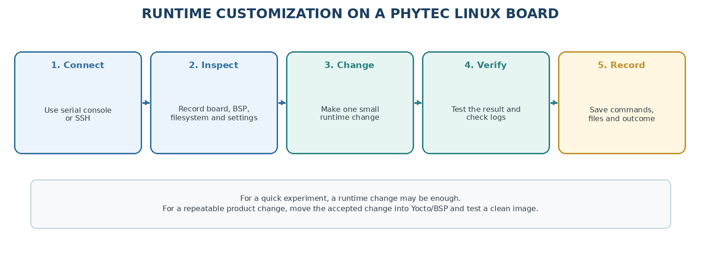
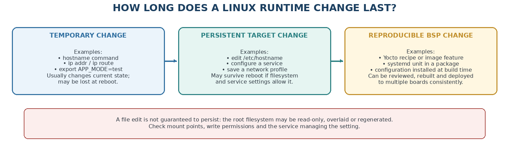
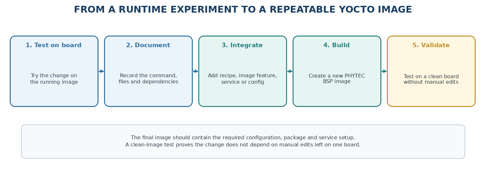

.. START:section:1:1
1. What is runtime customization?
=================================

.. END:section:1:1

.. START:main_content:1:1
Linux Runtime System Customization for PHYTEC BSP usage. This document describes runtime customization after boot, distinguishes temporary/persistent/reproducible changes, and explains how to migrate validated runtime experiments into Yocto image configuration.

Runtime customization means changing a Linux system after the PHYTEC board has already booted. You work from the board shell through the serial console or SSH. You can change settings, users, services, network configuration and files without rebuilding the kernel or full BSP for every experiment.

.. END:main_content:1:1

.. START:table:1:1:1

.. csv-table:: Table 2  -  Runtime change versus BSP change
   :header: "Change type", "What happens"
   :align: center

   "Runtime experiment", "Changes the running board immediately; may be lost at reboot"
   "Persistent target change", "Stored in the target filesystem; may survive reboot but is difficult to reproduce"
   "BSP/Yocto change", "Built into a repeatable image and can be installed on many boards"

.. END:table:1:1:1

.. START:image:1:1:1

   Figure-1 Runtime Customization Workflow

.. END:image:1:1:1

|

.. START:table:1:1:2

.. csv-table::
.. tip::

   Use the runtime board for quick learning and diagnosis. Use Yocto for changes that must survive reflashing, be reviewed or be applied to multiple products.

.. END:table:1:1:2

.. START:section:1:2
2. Connect to the running PHYTEC board
======================================

.. END:section:1:2

.. START:main_content:1:2
PHYTEC Quickstart guides commonly use a serial console for first access. SSH is useful after the network is working.

::

   # On the host, identify the serial device and connect with the settings
   # documented for your PHYTEC board.
   
   # After Linux starts, connect over SSH if enabled
   $ ssh <user>@<board-ip>
   
   # Record the target identity
   $ uname -a
   $ cat /etc/os-release
   $ cat /proc/device-tree/model 2>/dev/null; echo

.. END:main_content:1:2

.. START:table:1:2:1

.. csv-table:: Table 3  -  Ways to access Linux
   :header: "Connection", "Best use"
   :align: center

   "Serial console", "First boot, boot logs, recovery and network troubleshooting"
   "SSH", "Normal development after the board has an IP address"
   "Local keyboard/display", "Interactive work when the product has a console"
   "Network file transfer", "Copy test binaries and configuration files"

.. END:table:1:2:1

.. START:table:1:2:2

.. csv-table::
.. warning::

   Do not assume the default user, password, IP address or serial speed. Use the exact PHYTEC release and board Quickstart guide.

.. END:table:1:2:2

.. START:image:1:2:2

   Figure-2 Temporary vs Persistent Changes

.. END:image:1:2:2

|

.. START:section:1:3
3. Understand the target filesystem
===================================

.. END:section:1:3

.. START:main_content:1:3
An embedded Linux image normally has a read-only or writable root filesystem, a temporary /run or /tmp, and persistent storage such as /data, a dedicated data partition or an overlay.

::

   $ mount
   $ df -h
   $ findmnt
   $ ls -ld /etc /var /run /tmp /data 2>/dev/null

.. END:main_content:1:3

.. START:table:1:3:1

.. csv-table:: Table 4  -  Common Linux directories
   :header: "Directory", "Typical use"
   :align: center

   "/etc", "System configuration, users, network and service files"
   "/var", "Logs, state, caches and changing service data"
   "/home", "User files"
   "/usr", "Programs, libraries and shared read-only software"
   "/opt", "Optional vendor or application software"
   "/run", "Runtime state created during the current boot"
   "/tmp", "Temporary files; often cleared on reboot"
   "/data", "Product-specific persistent application data, when configured"

.. END:table:1:3:1

.. START:table:1:3:2

.. csv-table::
.. important::

   The location and write permissions of a directory depend on the PHYTEC image. Check the mount table before storing important files.

.. END:table:1:3:2

.. START:image:1:3:3

   Figure-3 Runtime Experiment to Yocto Image

.. END:image:1:3:3

|

.. START:section:1:4
4. Change the hostname
======================

.. END:section:1:4

.. START:main_content:1:4
A hostname identifies the board on a network and in shell prompts. A temporary hostname can be useful during a test. A persistent hostname belongs in the image configuration or the target's persistent /etc configuration.

::

   # Show the current name
   $ hostname
   $ hostnamectl status 2>/dev/null
   
   # Temporary change for the current boot
   $ hostname phyboard-test
   $ hostname

On images using systemd, hostnamectl may manage the persistent hostname. On smaller images, the hostname may be read from /etc/hostname or an init script.

::

   # Inspect the configuration before editing
   $ cat /etc/hostname 2>/dev/null
   $ grep -RIn 'hostname' /etc 2>/dev/null | head
   
   # If the image uses /etc/hostname, edit it with the available editor
   $ printf '%s\n' phyboard-test > /etc/hostname

.. END:main_content:1:4

.. START:table:1:4:1

.. csv-table::
.. warning::

   Do not overwrite /etc/hostname on a read-only or production filesystem without confirming how the image manages configuration. Save a backup first.

.. END:table:1:4:1

.. START:section:1:5
5. Change the login banner
==========================

.. END:section:1:5

.. START:main_content:1:5
A login banner can show the product name, software version and support contact. It can be useful during board bring-up, but it should not expose passwords, keys or sensitive network information.

::

   # Inspect common banner files
   $ cat /etc/issue 2>/dev/null
   $ cat /etc/motd 2>/dev/null
   $ ls -l /etc/profile.d 2>/dev/null
   
   # Test a banner change
   $ printf '%s\n' 'PHYTEC development board - test image' > /etc/motd

.. END:main_content:1:5

.. START:table:1:5:1

.. csv-table:: Table 5  -  Banner files
   :header: "File", "When it may be shown"
   :align: center

   "/etc/issue", "Before local console login on many systems"
   "/etc/motd", "Message of the day after a successful login"
   "/etc/profile", "Shell setup for login shells"
   "/etc/profile.d/", "Additional shell setup scripts"

.. END:table:1:5:1

.. START:section:1:6
6. Add and manage users
=======================

.. END:section:1:6

.. START:main_content:1:6
Use a separate non-root user for normal work. Root is useful for board administration but increases the damage caused by a mistake.

::

   # Inspect users and groups
   $ id
   $ cat /etc/passwd
   $ cat /etc/group
   
   # Create a development user when the image provides these tools
   $ adduser developer
   $ passwd developer
   $ id developer

Some minimal images use BusyBox commands, while larger images provide shadow utilities. Run help or command -v adduser useradd passwd before using a command.

.. END:main_content:1:6

.. START:table:1:6:1

.. csv-table::
.. important::

   Do not place passwords, private keys or production credentials in a document, image recipe or shell history. Use the product security process for account provisioning.

.. END:table:1:6:1

.. START:section:1:7
7. Configure SSH access
=======================

.. END:section:1:7

.. START:main_content:1:7
SSH is convenient, but it increases the attack surface. Enable it only when the image includes and supports an SSH service. Prefer key-based authentication and disable unnecessary root login for a product.

::

   # Inspect SSH service and listening ports
   $ ps | grep -i ssh
   $ ss -lntp 2>/dev/null
   $ systemctl status ssh 2>/dev/null || systemctl status sshd 2>/dev/null
   
   # Inspect service files without changing them
   $ ls -l /etc/ssh 2>/dev/null
   $ grep -E '^(PermitRootLogin|PasswordAuthentication|PubkeyAuthentication)'     /etc/ssh/sshd_config 2>/dev/null

.. END:main_content:1:7

.. START:table:1:7:1

.. csv-table::
.. warning::

   Do not expose a test board to an untrusted network with default credentials or unrestricted root SSH access.

.. END:table:1:7:1

.. START:section:1:8
8. Configure networking at runtime
==================================

.. END:section:1:8

.. START:main_content:1:8
Runtime network changes are useful for testing Ethernet, Wi-Fi or a static address. The exact persistent method depends on the PHYTEC image: systemd-networkd, NetworkManager, connman, ifupdown or a product service.

::

   # Inspect interfaces and addresses
   $ ip link
   $ ip addr
   $ ip route
   $ cat /etc/resolv.conf
   
   # Temporary address and route example
   $ ip link set eth0 up
   $ ip addr add <address>/<prefix> dev eth0
   $ ip route add default via <gateway>
   
   # Test connectivity
   $ ping -c 3 <gateway>
   $ ping -c 3 <server>

.. END:main_content:1:8

.. START:table:1:8:1

.. csv-table:: Table 6  -  Temporary and persistent network changes
   :header: "Type", "Effect"
   :align: center

   "ip command", "Changes the running kernel network state; usually lost at reboot"
   "NetworkManager profile", "Can persist if NetworkManager manages the interface"
   "systemd-networkd file", "Can persist if systemd-networkd is enabled"
   "ifupdown configuration", "Can persist on images using /etc/network/interfaces"
   "Yocto image policy", "Best for a repeatable product default"

.. END:table:1:8:1

.. START:table:1:8:2

.. csv-table::
.. tip::

   If you change the address through SSH, your connection may drop. Keep the serial console connected before testing network changes.

.. END:table:1:8:2

.. START:section:1:9
9. Find which service manages networking
========================================

.. END:section:1:9

.. START:main_content:1:9
Do not configure the same interface with two network managers. Find the active service first.

::

   $ systemctl --type=service --state=running 2>/dev/null | grep -Ei 'network|connman|manager'
   $ ps | grep -Ei 'NetworkManager|systemd-networkd|connmand|dhcpcd|udhcpc'
   $ ls -l /etc/systemd/network /etc/NetworkManager /etc/network 2>/dev/null

.. END:main_content:1:9

.. START:table:1:9:1

.. csv-table:: Table 7  -  Network troubleshooting evidence
   :header: "Command", "What it shows"
   :align: center

   "ip link", "Interface exists and its administrative state"
   "ip addr", "IPv4/IPv6 addresses"
   "ip route", "Routes and default gateway"
   "resolvectl status", "DNS state on supported systemd images"
   "journalctl -u <service>", "Service startup and configuration errors"

.. END:table:1:9:1

.. START:section:1:10
10. Manage services
===================

.. END:section:1:10

.. START:main_content:1:10
Services are background programs such as SSH, network management, logging, a product application or a hardware test. On systemd images, systemctl shows and controls them. Other images may use BusyBox init scripts.

::

   # Inspect services
   $ systemctl list-units --type=service 2>/dev/null
   $ systemctl status <service-name> 2>/dev/null
   $ systemctl is-enabled <service-name> 2>/dev/null
   
   # Test a service for the current boot
   $ systemctl start <service-name>
   $ systemctl stop <service-name>
   $ systemctl restart <service-name>
   
   # Enable or disable future boots only after review
   $ systemctl enable <service-name>
   $ systemctl disable <service-name>

.. END:main_content:1:10

.. START:table:1:10:1

.. csv-table::
.. important::

   Starting a service and enabling a service are different. start affects the current boot; enable changes future boot behavior.

.. END:table:1:10:1

.. START:section:1:11
11. Read logs and diagnose services
===================================

.. END:section:1:11

.. START:main_content:1:11
Logs explain why a service did not start or why a network, application or hardware test failed.

::

   # systemd-based image
   $ journalctl -b
   $ journalctl -u <service-name> -b
   $ journalctl -p warning..alert -b
   
   # Images using traditional log files
   $ logread 2>/dev/null
   $ tail -n 100 /var/log/messages 2>/dev/null
   $ tail -n 100 /var/log/syslog 2>/dev/null

.. END:main_content:1:11

.. START:table:1:11:1

.. csv-table:: Table 8  -  Service failure checks
   :header: "Check", "Question"
   :align: center

   "Status", "Is the service active, failed or repeatedly restarting?"
   "Logs", "What error did the service report?"
   "Path", "Does the executable and configuration file exist?"
   "User", "Does the service user have permission to its files/devices?"
   "Dependencies", "Are network, storage, firmware or hardware devices ready?"
   "Port", "Is another service already using the required port?"

.. END:table:1:11:1

.. START:table:1:11:2

.. csv-table::
.. warning::

   Do not hide a service failure by repeatedly restarting it. Read the log and fix the first reported cause.

.. END:table:1:11:2

.. START:section:1:12
12. Change environment variables and shell setup
================================================

.. END:section:1:12

.. START:main_content:1:12
A shell variable can affect one command, one shell session or future login sessions. Know which scope you are changing.

::

   # Current shell only
   $ export APP_MODE=test
   $ echo $APP_MODE
   
   # Check common persistent shell files before editing
   $ cat /etc/profile 2>/dev/null
   $ ls -l /etc/profile.d 2>/dev/null
   $ cat ~/.profile 2>/dev/null
   $ cat ~/.bashrc 2>/dev/null

.. END:main_content:1:12

.. START:table:1:12:1

.. csv-table:: Table 9  -  Variable scope
   :header: "Scope", "Typical lifetime"
   :align: center

   "Command prefix", "One command, for example APP_MODE=test ./app"
   "export in shell", "Current shell and child processes"
   "User profile", "Future login shells for one user"
   "System profile", "Future login shells for many users"
   "Service environment", "Only the service, often configured in its unit file"
   "Yocto metadata", "Repeatable value in the generated image"

.. END:table:1:12:1

.. START:section:1:13
13. Change time, timezone and locale
====================================

.. END:section:1:13

.. START:main_content:1:13
Time settings affect logs, certificates, scheduled tasks and applications. A board without a real-time clock or network time may start with an incorrect date.

::

   $ date
   $ timedatectl status 2>/dev/null
   $ cat /etc/timezone 2>/dev/null
   $ locale
   
   # Temporary time test; use the documented method for persistent settings
   $ date -s '2026-10-28 17:00:00'

.. END:main_content:1:13

.. START:table:1:13:1

.. csv-table::
.. important::

   Do not set the system clock manually on a production device without checking the time-synchronization design. NTP, a hardware RTC and a product time service may overwrite the value.

.. END:table:1:13:1

.. START:section:1:14
14. Install or copy test software
=================================

.. END:section:1:14

.. START:main_content:1:14
A runtime test may use a preinstalled tool, a copied binary, a package manager or a program built with the PHYTEC SDK. This is useful for experiments, but manually copied software is not yet a reproducible product change.

::

   # Inspect architecture and available tools
   $ uname -m
   $ command -v gcc make opkg apt apk 2>/dev/null
   $ df -h
   
   # Copy a test program from the host, then run it
   $ scp <test-program> <user>@<board-ip>:/tmp/
   $ chmod +x /tmp/<test-program>
   $ /tmp/<test-program>

.. END:main_content:1:14

.. START:table:1:14:1

.. csv-table:: Table 10  -  Runtime software choices
   :header: "Method", "Best use"
   :align: center

   "Preinstalled command", "Quick diagnosis and hardware checks"
   "Copy to /tmp", "Short-lived test that should disappear after reboot"
   "Copy to /opt or /data", "Longer experiment when persistent storage is intended"
   "Package manager", "Install a package if the image and repository support it"
   "Yocto recipe", "Production software that must be reproducible"

.. END:table:1:14:1

.. START:table:1:14:2

.. csv-table::
.. warning::

   Do not replace system libraries or boot-critical programs on a test board without a recovery image. A copied binary can also be built for the wrong CPU architecture.

.. END:table:1:14:2

.. START:section:1:15
15. Make a runtime change persistent
====================================

.. END:section:1:15

.. START:main_content:1:15
There are two ways to keep a runtime change: edit the target filesystem directly, or move the change into the BSP build. The second method is preferred for products.

.. END:main_content:1:15

.. START:table:1:15:1

.. csv-table:: Table 11  -  Where to integrate a successful runtime change
   :header: "Runtime experiment", "Production location"
   :align: center

   "Hostname/banner", "Yocto rootfs configuration or a custom recipe"
   "User/group", "Image recipe, user management class or product provisioning"
   "Network profile", "Machine/image configuration or product network package"
   "Service enablement", "systemd unit and recipe, or image feature"
   "Application binary", "Application recipe and package"
   "Configuration file", "Recipe file:// entry and do_install task"

.. END:table:1:15:1

.. START:table:1:15:2

.. csv-table::
.. tip::

   Write down the exact commands you used while experimenting. That record becomes the input for a clean Yocto recipe or image configuration.

.. END:table:1:15:2

.. START:section:1:16
16. Runtime customization checklist
===================================

.. END:section:1:16

.. START:main_content:1:16
1. Connect through the documented serial console or a trusted SSH connection.

2. Record the board model, BSP release, kernel version and mount layout.

3. Check whether the root filesystem is writable and where persistent data belongs.

4. Make one small change and save a backup of the original file.

5. Test the current boot before enabling a persistent service or setting.

6. Read logs and verify the result with a measurable command.

7. Record the change, package and file that produced the result.

8. Move the accepted change into Yocto/BSP metadata.

9. Build a clean image and test it without the manual runtime edit.

.. END:main_content:1:16

.. START:section:1:17
17. Common problems
===================

.. END:section:1:17

.. START:table:1:17:1

.. csv-table:: Table 12  -  Linux runtime customization troubleshooting
   :header: "Symptom", "Likely cause", "First action"
   :align: center

   "Change disappears after reboot", "Only the running system was changed", "Move it to persistent configuration or Yocto"
   "File cannot be written", "Read-only filesystem or insufficient permission", "Check mount, findmnt and user identity"
   "SSH connection drops", "Network address or service was changed", "Use the serial console and restore the known-good network setting"
   "Service will not start", "Bad configuration, missing dependency or port conflict", "Read systemctl status and service logs"
   "Program will not execute", "Wrong architecture, missing loader or permission", "Run file, uname -m, ldd and check execute permission"
   "Hostname changes but not everywhere", "Multiple services manage hostname or cached name", "Inspect /etc/hostname, resolver and network manager"
   "Image behaves differently from test board", "Manual change was not integrated into BSP", "Rebuild from clean Yocto metadata and compare"

.. END:table:1:17:1

.. START:section:1:18
18. Roll back a runtime change
==============================

.. END:section:1:18

.. START:main_content:1:18
Before changing a configuration file, save a copy and record the original command. If the test fails, restore the copy, stop or disable the changed service, and reboot only after the board is in a known-good state. This is the rollback procedure for the experiment.

cp /etc/<file> /etc/<file>.bak # restore the previous file when required cp /etc/<file>.bak /etc/<file> systemctl daemon-reload 2>/dev/null systemctl restart <service-name> 2>/dev/null

.. END:main_content:1:18

.. START:section:1:19
19. Summary
===========

.. END:section:1:19

.. START:main_content:1:19
Runtime customization is the fastest way to test a PHYTEC Linux system. Use serial or SSH access to inspect files, users, networking, services, logs, time and applications. Remember that runtime changes may be temporary or difficult to reproduce. Once a change is accepted, move it into the PHYTEC Yocto/BSP build and verify it on a clean image.

.. END:main_content:1:19

.. START:table:1:19:1

.. csv-table::
.. note::

   A manual change proves that an idea works on one running board. A Yocto change proves that the product can reproduce it.

.. END:table:1:19:1

.. START:table:1:19:2

.. csv-table:: Table 25 - Documentation details
   :header: "Note— Runtime changes are excellent for experiments, but they are not automatically part of the next BSP image or a clean-board test."
   :align: center

.. END:table:1:19:2

.. START:table:1:19:3

.. csv-table:: Table 26 - Documentation details
   :header: "Caution— Changing network settings, SSH configuration or service startup remotely can disconnect the session. Keep serial-console access during testing."
   :align: center

.. END:table:1:19:3

.. START:section:1:20
20. References
==============

.. END:section:1:20

.. START:main_content:1:20
Use the documentation for the exact PHYTEC board and BSP release. The links below provide product-specific and upstream reference material.

`PHYTEC Documentation Home <https://docs.phytec.com/>`_

`PHYTEC AM62x Linux Application Development <https://docs.phytec.com/projects/yocto-phycore-am62x/en/latest/applicationdevelopment/linux/>`_

`PHYTEC AM62x Quickstart Guide <https://docs.phytec.com/projects/yocto-phycore-am62x/en/latest/quickstart.html>`_

`PHYTEC AM62x BSP Build Guide <https://docs.phytec.com/projects/yocto-phycore-am62x/en/latest/building.html>`_

`systemd Documentation <https://systemd.io/>`_

`Linux Kernel Networking Documentation <https://docs.kernel.org/networking/>`_

Supplied NXP kernel tree: linux-phytec-imx-6.12.34-2.1.0-phy9/

Supplied TI kernel tree: linux-phytec-ti-6.1.80-09.02.00.009-phy8/

.. END:main_content:1:20
